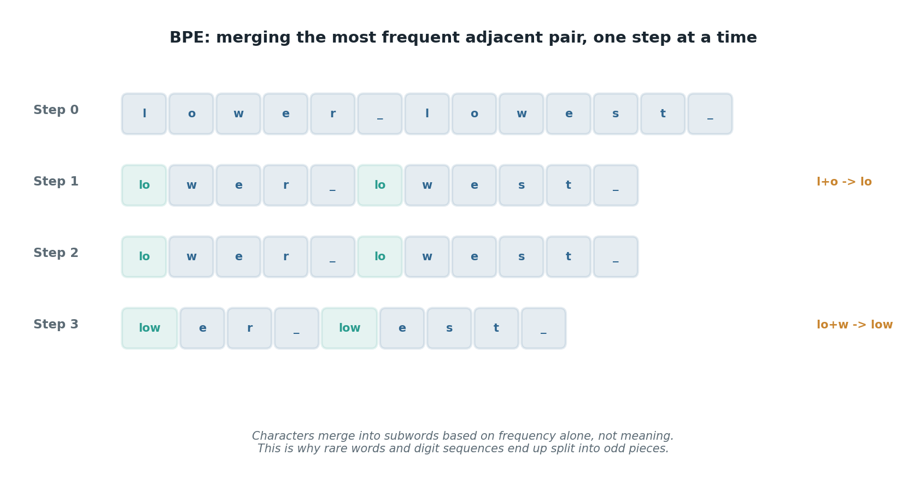

# Tokens and counting

## What the code showed you

You sent three pieces of text to a real model and looked at `usage.prompt_tokens` in the response: an ordinary sentence, a made-up word, and a long number. The tokens-per-word ratio moved around depending on what the text actually contained. That number is also exactly what you're billed on.

## What's actually happening underneath that

*Each step merges whichever adjacent pair showed up most often in training. This is the actual algorithm, not a simplification, run here on a short example so every step fits on screen.*

Text gets cut into chunks before a model ever sees it, using an algorithm called Byte Pair Encoding, BPE for short. It starts by treating every character as its own token, then repeatedly merges whichever pair of adjacent tokens shows up most often in a huge pile of training text, over and over, until it hits a target vocabulary size. GPT-style models land around 100,000 tokens in that vocabulary; common whole words get one token each, rare or made-up words get split into smaller, more familiar pieces.

This is also exactly why your made-up word and your long number behaved differently from the plain sentence. A real word the tokenizer has seen a thousand times gets to be one token. A number like 48213967 gets split in a way that has nothing to do with place value, because the merge rule only ever cared about which byte sequences were common, never about what a number means.

## Resources, in the order I'd actually use them

**Interactive, play with it first**
- [BPE Tokenization Visualizer](https://www.bpe-visualizer.com/) — type any text in and watch the merge steps happen one at a time, including which pair got merged and why. Ten minutes here will make the rest of this list click faster.

**Read next**
- [What is Tokenization in LLMs? BPE, SentencePiece, tiktoken in 2026](https://futureagi.com/blog/what-is-tokenization-llms-2026/) — the clearest current explainer, covers why BPE won over the alternatives and what byte-level BPE specifically fixes (it means no input can ever be truly "unknown" to the tokenizer, since it can always fall back to raw bytes).
- [Tokenization Guide — BPE, SentencePiece & Token Counting (2026)](https://myengineeringpath.dev/genai-engineer/tokenization/) — walks the actual merge algorithm step by step on a tiny example, with the vocabulary sizes for GPT-2 through GPT-4 and LLaMA 2 compared directly.

**If you want the original mechanics explained plainly, no AI-specific framing**
- [Byte-Pair Encoding (BPE) in NLP — GeeksforGeeks](https://www.geeksforgeeks.org/nlp/byte-pair-encoding-bpe-in-nlp/) — BPE predates LLMs by decades, it started as a 1994 compression technique. This is useful if you want to see the idea without any language-model framing attached to it at all.

## The one thing worth remembering

Tokens-per-word is not a fixed number. It depends on what's actually in the text. Code, non-English text, and long numbers all tokenize worse than plain English prose, often by a wide margin. If a cost estimate assumes a flat ratio, it's already wrong before anything else goes wrong.
