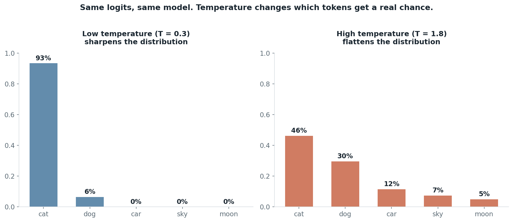

# Same prompt, different answers

## What the code showed you

The offline part proved the request itself is byte-identical every time, nothing about what leaves your machine changes between calls. The live part then sent that identical prompt three times at a higher temperature and three times near zero. The high-temperature run gave you noticeably different wording each time. The near-zero run mostly converged, but even that one isn't guaranteed to be perfectly identical, which is a real and currently-documented fact, not a bug in the code.

## What's actually happening underneath that

*Same five scores on both sides. Only the temperature changed. At T = 0.3 one token dominates completely; at T = 1.8 even the least likely token has a real, if small, chance of being picked.*

At every single step, the model produces a score, called a logit, for every possible next token. Temperature divides those logits before they go through softmax. Divide by a small number and the gap between the best token and everything else gets exaggerated, so the top choice dominates almost completely. Divide by a larger number and the gap flattens, so tokens that were only somewhat likely get a real chance of being picked. Then the decoder samples one token from whatever distribution comes out the other end. That sampling step is where the randomness actually lives, not in the model "changing its mind."

The part worth sitting with: temperature 0 is often described as deterministic, and it is much closer to deterministic than any other setting, but it is not guaranteed to be perfectly repeatable. Anthropic's own documentation states plainly that even at temperature 0, results will not be fully deterministic. OpenAI describes its seed parameter the same way, as best effort, not a guarantee. Small differences in how a provider batches requests on their servers, or a backend update you'd never see, can still shift the output slightly. Worth also knowing: some current Anthropic models have dropped the temperature parameter entirely, so "set temperature to 0" isn't even an option on every model going forward.

## Resources, in the order I'd actually use them

**Read first, it's short and current**
- [Output from AI LLMs is Non-Deterministic. What that means](https://www.sitation.com/blog/non-determinism-in-ai-llm-output/) — a 2026 piece that states the Anthropic and OpenAI documentation directly, including the "not fully deterministic even at temperature 0" line and the fact that some current Claude models no longer expose temperature at all.

**For the full picture, every lever you can pull**
- [Non-Deterministic LLM Prompts in 2026: A Practical Guide](https://futureagi.com/blog/non-deterministic-llm-prompts-2025/) — lays out temperature, top-k, top-p, seeds, and version pinning side by side, with when to actually use each one. The honest line in this one: evaluate non-deterministic systems by running each prompt multiple times and reporting the spread, never by a single run.

**If you want the math itself, worked with real numbers**
- [LLM Sampling Parameters Explained: Intuition to Math](https://letsdatascience.com/blog/llm-sampling-temperature-top-k-top-p-and-min-p-explained) — shows the actual probability shift at different temperatures on a toy example (one token going from 99.3% likely at low temperature to a flat field at high temperature), plus a Python implementation you can read line by line.

## The one thing worth remembering

Non-determinism is not a defect to work around with cleverer prompting. It's a property of sampling, and the only honest way to deal with it in a real system is to design evaluation and product behavior that tolerates it, rather than chasing a repeatability guarantee that the providers themselves say doesn't exist.
