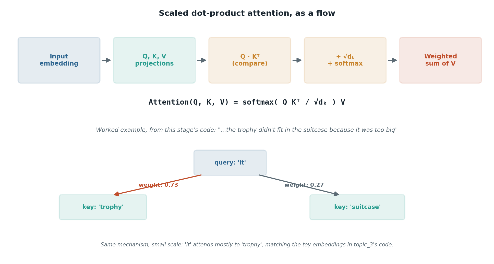

# The rough shape of attention

## What the code showed you

A toy sentence with "it" needing to refer back to either "trophy" or "suitcase," three hand-written vectors standing in for real embeddings, and a dot-product-plus-softmax calculation that correctly picked "trophy" because its toy embedding was built to be close to "it." That example wasn't invented for this project. It's the same pronoun-resolution example used across the field's actual teaching material on attention, which is worth knowing, because it means the code just walked you through the standard way this gets taught, not an invented shortcut.

## What's actually happening underneath that

*The bottom half is not a separate example, it's the exact same numbers `topic_3_attention_rough_shape/main.py` prints when you run it. The diagram and the code are describing the same calculation.*

Every word gets turned into three separate vectors through three separate learned transformations: a query (what this word is looking for), a key (what this word offers to others), and a value (the actual content it contributes if selected). To figure out how much one word should attend to another, you take the first word's query and dot it against the second word's key. Do that against every other word, scale the results down by the square root of the key dimension (this stops the numbers from growing so large that softmax saturates and gradients stop flowing during training), then run softmax so the scores become weights that sum to one. The output is a weighted blend of every word's value vector, weighted by how well its key matched the query.

The library analogy from one of the resources below is worth keeping: a query is what you're searching for, a key is the label on a book's spine, a value is what's actually written inside. You compare your search against every spine, and the books whose labels match best contribute the most to what you walk away with. Nothing about this is a hard, one-word lookup. It's a soft blend across everything, weighted by relevance.

## Resources, in the order I'd actually use them

**Read this one first, it's current and interactive**
- [The Attention Mechanism Explained (2026)](https://techjacksolutions.com/ai-knowledge-hub/attention-mechanism/) — an interactive 2026 lesson that walks query/key/value, scaled dot-product attention, and multi-head attention in sequence, with the same "database lookup" framing used below.

**The classic visual reference, still the best one**
- Jay Alammar, [*The Illustrated Transformer*](https://jalammar.github.io/illustrated-transformer/) — the diagram-heavy reference nearly everyone in this field has open in a tab at some point. Worth it specifically for how it shows Q, K, V as a picture, not just an equation.

**If you want the library analogy spelled out properly**
- [The Q, K, V Matrices](https://arpitbhayani.me/blogs/qkv-matrices/) — walks the database-lookup framing in plain language before it ever shows an equation, good if the math-first explanations aren't landing.

**Video, for when you want it talked through**
- Andrej Karpathy, [*Let's build GPT: from scratch, in code, spelled out*](https://www.youtube.com/watch?v=kCc8FmEb1nY) — builds attention from nothing, in actual code, so you see every matrix multiply as it happens rather than reading about it after the fact.

## The one thing worth remembering

This project deliberately stopped short of the real formula, `Attention(Q, K, V) = softmax(QKᵀ / √d_k) V`, and the actual learned Q/K/V projection matrices. That's Stage 2's job, once the linear algebra under it has been covered properly. What you should walk away with here is the shape of the idea: compare, weight, blend, nothing more yet.
