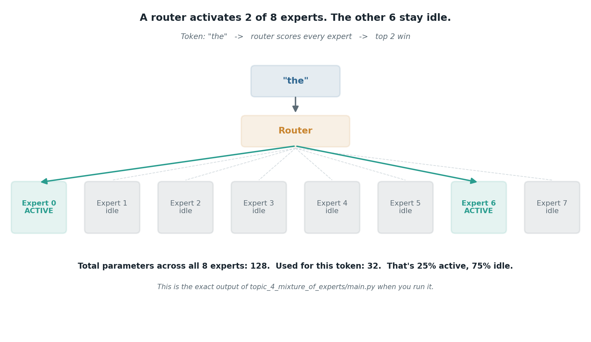
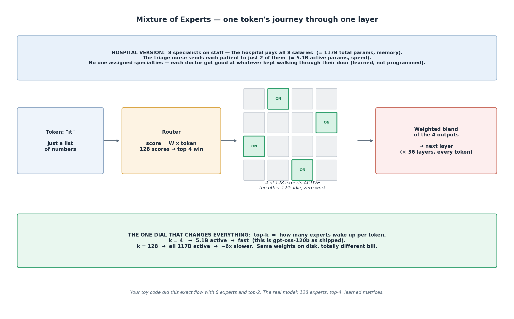

# Mixture of Experts

## What the code showed you

A toy router with 8 experts, each a small matrix. For every token, the router scored all 8 and picked the top 2. 128 total parameters across all experts, only 32 actually used per token, a fixed 25% active no matter which token came through. Different words activated different expert pairs. The mechanism is exactly this, just at a scale of billions instead of dozens.

## What's actually happening underneath that

*These are the actual numbers `topic_4_mixture_of_experts/main.py` prints. Not a generic illustration, this repo's own output.*

A dense model, the kind described earlier in this stage, runs every single parameter on every single token. A Mixture of Experts model replaces that with a router: a small network that looks at each token and decides which few "expert" sub-networks, out of many available, should handle it. Only the chosen experts do any work. The rest sit idle for that token, and which ones sit idle changes on the next token.

This is specifically why `openai/gpt-oss-120b`, the model used throughout this stage, can run at roughly half the speed of the much smaller `gpt-oss-20b` rather than six times slower. Most of its 120 billion parameters are idle at any given moment. You're not paying compute for the whole model on every word, only for whichever experts got picked.

The concrete number worth remembering: Mixtral 8x7B, a well-documented open MoE model, stores 46.7 billion parameters total but only uses about 12.9 billion of them per token. Size on disk and compute cost per token are two different numbers once MoE is involved, and conflating them is a common mistake.

## Resources, in the order I'd actually use them

**Read this one first, it's current and well organized**
- [Transformer Architecture in 2026: From Attention to Mixture of Experts](https://dev.to/jintukumardas/transformer-architecture-in-2026-from-attention-to-mixture-of-experts-moe-3d46) — lays out MoE alongside the other architecture shifts of 2026 (sparse attention, state space models), good for seeing where MoE fits in the bigger picture rather than in isolation.

**For the concrete numbers and the real tradeoffs**
- [LLM Architecture Explained: Transformers, MoE, KV Cache](https://kanerika.com/blogs/llm-architecture/) — this is where the Mixtral 46.7B-total/12.9B-active figure comes from, plus a clear explanation of why memory and compute have to be judged separately for MoE models.

**For the FAQ-style summary**
- [LLM Concepts Explained 2026](https://blog.buildfastwithai.com/llm-concepts) — a direct, plain definition of MoE and how it connects to the KV cache and quantization, useful if you want the short version before the longer reads.

## The tradeoffs worth knowing, not just the upside

MoE isn't free capability. Three real costs:

- **Memory doesn't shrink.** Every expert, used or not, still has to be loaded. You get speed, not a smaller footprint.
- **Training the router evenly is genuinely hard.** It can learn to lean on a handful of favorite experts and effectively ignore the rest, a known failure mode usually called load imbalance.
- **A bad routing decision is a new failure mode.** A dense model can only be wrong about its output. An MoE model can also be wrong about which part of itself should have answered at all.

## The one thing worth remembering

"120 billion parameters" and "120 billion parameters doing work right now" are not the same claim once MoE is involved. Always ask which one a number is describing before comparing two models by parameter count alone.

## The hospital version (same mechanism, plain words)

A hospital employs 8 specialists and pays all 8 salaries whether patients show up or not. That's the 117B total — the payroll, the memory footprint, roughly "how much the model can know." The triage nurse looks at each patient and sends them to just 2. That's the 5.1B active — the cost of *this* patient, the speed.

The nurse never got a rulebook. Nobody hung nameplates on the doors. Each doctor just got good at whatever kept walking through their door — that's training. The router's weights and the experts all start random, and training slowly shifts them so that experts producing useful outputs for a kind of token get sent more of those tokens. Specialization emerges; it isn't assigned.

One token, for real: "it" in "the trophy didn't fit in the suitcase because it was too big" is just a list of numbers. The router multiplies it by its weight matrix, gets 128 scores, and the top 4 experts light up — the other 124 do nothing. Their 4 outputs blend into one and go to the next layer. This repeats across all 36 layers, fresh for every token.

The one dial: top-k, how many experts wake up per token. k=4 → 5.1B active, fast. k=128 → all 117B active, ~6x slower. Same weights on disk, totally different bill.
