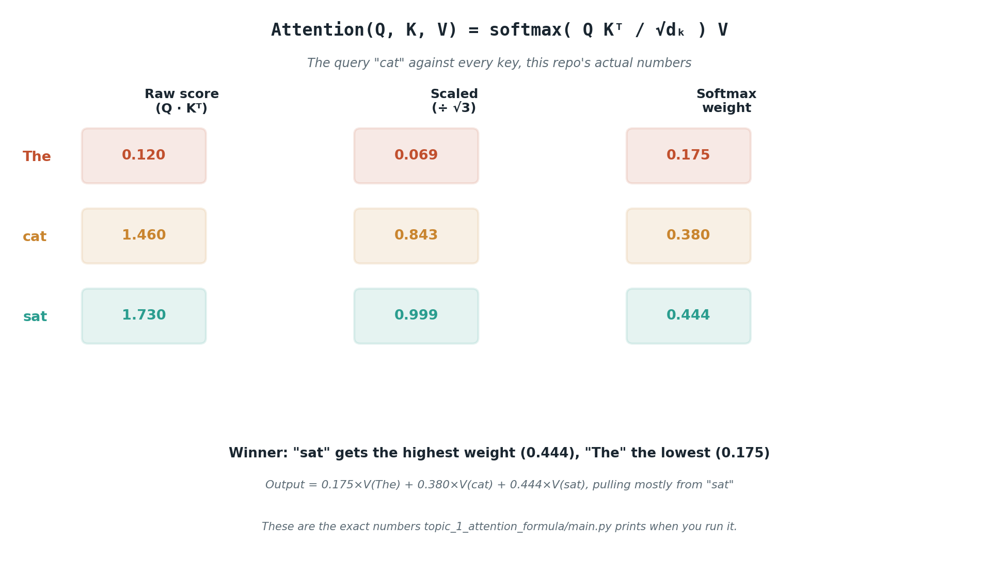

# The real attention formula

## What the code showed you

The toy query "cat" compared against three keys, scaled, run through softmax, and used to blend three value vectors. "sat" won with a weight of 0.444, "The" lost with 0.175, and the final output vector pulled mostly from "sat"'s value. Every number came from the actual formula, not an approximation of it.

## What's actually happening underneath that

*These are the exact numbers `topic_1_attention_formula/main.py` prints.*

Stage 1 showed the rough shape: compare, weight, blend. The actual formula is `Attention(Q, K, V) = softmax(QKᵀ / √d_k)V`. In a real model, Q, K, and V for every token come from projecting that token's embedding through three separate learned weight matrices, plain matrix multiplication, the exact operation covered in Stage 1. What this topic adds is everything that happens once you have Q, K, and V: the dot product comparison, the scaling, the softmax, and the final weighted blend.

The scaling step, dividing by √d_k, exists for a specific reason. Dot products between higher-dimensional vectors tend to grow larger purely because there are more terms being summed. Larger raw scores pushed into softmax produce an almost one-hot distribution, nearly all the weight on a single token, which throws away the soft blending that makes attention useful in the first place. Dividing by √d_k keeps the scores in a range where softmax still produces a meaningful spread.

## Resources, in the order I'd actually use them

**The clearest current step-by-step walkthrough**
- [Attention Mechanism in LLMs Explained (2026)](https://www.buildfastwithai.com/blogs/attention-mechanism-llm-explained) — walks Q, K, V construction, the scaling step, and the full formula in the same order this code does, with the exact same pronoun-resolution framing ("it" referring to "animal" not "street") that Stage 1 already used.

**An interactive version, worth the ten minutes**
- [The Attention Mechanism Explained (2026)](https://techjacksolutions.com/ai-knowledge-hub/attention-mechanism/) — the same interactive lesson referenced in Stage 1's attention reading, now worth revisiting since you have the real formula to check it against.

**If the library analogy helps more than the equation**
- [The Q, K, V Matrices](https://arpitbhayani.me/blogs/qkv-matrices/) — frames Q as a search term, K as an index, V as the content, before it ever shows the formula.

## The one thing worth remembering

The scaling term isn't decoration. Remove it and run the same numbers through softmax unscaled, and one token's weight approaches 1 while the rest collapse toward 0, every time, as the vector dimension grows. √d_k is specifically the factor that keeps that from happening as models get wider.
