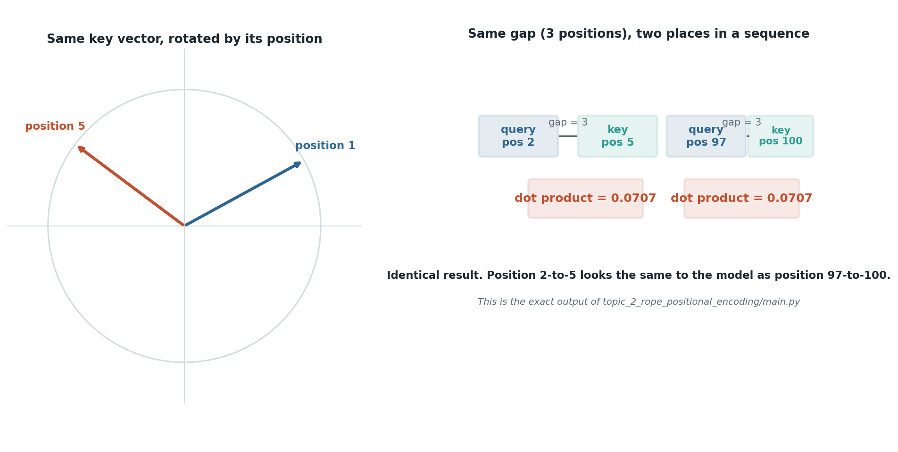

# RoPE: why order matters and how rotation encodes it

## What the code showed you

The same key vector rotated by two different amounts depending on its position. Then the real point: a query at position 2 and a key at position 5, three positions apart, produced a dot product of exactly 0.0707. A query at position 97 and a key at position 100, also three positions apart, produced the identical 0.0707. The model sees the gap, not the absolute position.

## What's actually happening underneath that

*The dot product values are exactly what `topic_2_rope_positional_encoding/main.py` prints.*

Attention by itself has no sense of order. Given only the attention formula from the previous topic, "the bank paid the client" and "the client paid the bank" would produce identical attention patterns, because attention compares vector content, and nothing about word order enters that comparison on its own.

RoPE fixes this by rotating each token's query and key vectors by an angle tied to that token's position, before the attention formula ever runs. The real version rotates multiple pairs of dimensions at different frequencies, not just one pair as in this toy version, but the mechanism is identical: a 2D rotation, applied per pair.

The property that makes this specifically useful, not just a way to inject position: rotating both a query and a key by their respective positions means their dot product afterward depends only on the difference between those positions, never on the absolute values. A gap of 3 looks the same to the model whether it happens at the very start of a sequence or deep inside one 10,000 tokens long. This is also why RoPE-based models tend to extrapolate to longer sequences better than models using plain additive position encoding, which has no such guarantee.

## Resources, in the order I'd actually use them

**For the current state of RoPE specifically, and what "dominant" means in practice**
- [Positional Encoding — Sinusoidal, RoPE, ALiBi](https://learn.traeai.com/t/ai-engineering/phases/07-transformers-deep-dive/04-positional-encoding) — confirms RoPE is the default across essentially every frontier open model as of 2026 (Llama, Qwen, Mistral, Mixtral, DeepSeek-V3, Kimi), and covers the extension methods (NTK-aware, YaRN, LongRoPE) used to stretch a model's context window past what it was trained on without retraining from scratch.

**The original scaling method, if you want the primary source**
- [YaRN: Efficient Context Window Extension of Large Language Models](https://arxiv.org/abs/2309.00071) — the paper behind the extension method most current long-context models actually use. The practical result worth remembering: YaRN needed 10x fewer tokens and 2.5x fewer training steps than earlier context-extension methods to hit the same result.

**For the plain-language version**
- [RoPE (Rotary Position Embedding)](https://ai-solutions.daviesmeyer.com/en/glossary/rotary-position-embedding) — states the relative-position property directly: "the inner product between rotated vectors automatically depends on relative position," which is exactly what this topic's code demonstrated with real numbers.

## The one thing worth remembering

If a positional encoding method can't guarantee that two tokens a fixed distance apart produce the same relationship regardless of where in the sequence that gap occurs, extending that model's context window later becomes much harder. RoPE's rotation is specifically built to provide that guarantee, which is the real reason it won.
