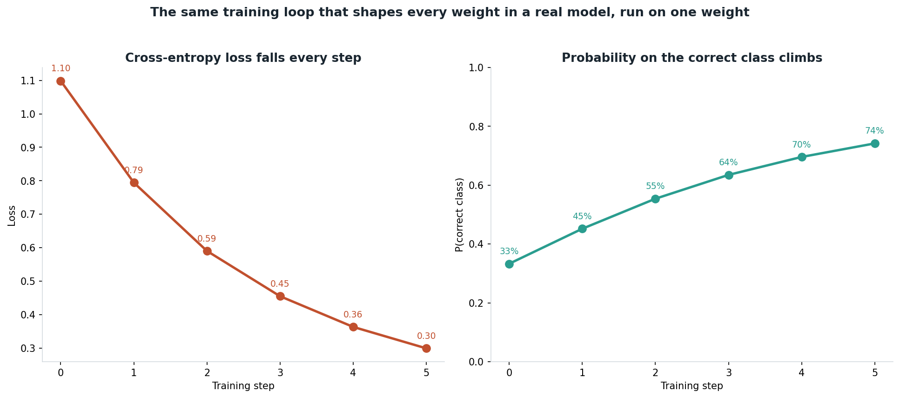

# Gradient descent and cross-entropy, the training signal

## What the code showed you

One weight, starting with no preference between three classes, trained to prefer the correct one. Loss fell from 1.10 to 0.30 across six steps. The probability assigned to the correct class climbed from 33% to 74%. Nothing was hand-tuned, the gradient alone decided which direction to move the weight at every step.

## What's actually happening underneath that

*Exactly what `topic_3_gradient_descent_cross_entropy/main.py` prints when you run it.*

Cross-entropy measures how wrong a prediction was by taking the negative log of the probability the model assigned to the actual correct answer. Confident and right costs almost nothing. Confident and wrong costs a lot, because the negative log of a small probability grows sharply as that probability shrinks toward zero. This is deliberate: a model that hedges when uncertain is more useful than one that is occasionally very confidently wrong.

The gradient is the direction that decreases this loss fastest, for every single weight, computed by calculus. In the softmax-plus-cross-entropy setup used here, that gradient has an unusually clean form: the predicted probabilities minus a one-hot vector marking the true class, scaled by the input. This isn't an approximation, it's the exact derivative worked out algebraically, which is part of why this particular combination (softmax output, cross-entropy loss) shows up everywhere in classification.

Gradient descent is just repeating this: compute the gradient, move every weight a small step in the direction that reduces loss, repeat. A real model has billions of weights instead of three, and trillions of training examples instead of one, but the loop itself is unchanged.

## Resources, in the order I'd actually use them

**For the visual intuition before the formulas**
- StatQuest's cross-entropy and gradient descent videos — the clearest visual walkthroughs available for how the loss surface actually looks and why gradient descent finds its way downhill.

**For seeing the exact math worked by hand**
- Any standard "softmax plus cross-entropy backpropagation" derivation (widely available in ML course notes) walks the same clean gradient this code uses, algebraically, step by step. Worth doing once on paper after seeing it in code.

**For where this connects forward**
- Jay Alammar's *The Illustrated Transformer* (already linked in Stage 1's attention reading) shows where this training signal flows back through in a real transformer, not just a single weight.

## The one thing worth remembering

The entire multi-trillion-parameter training process behind every model used in this project is this exact loop, scaled up. Forward pass, measure wrongness with cross-entropy, compute the gradient, nudge every weight, repeat. Nothing more mysterious is happening underneath, just far more of it, happening in parallel, for a very long time.
