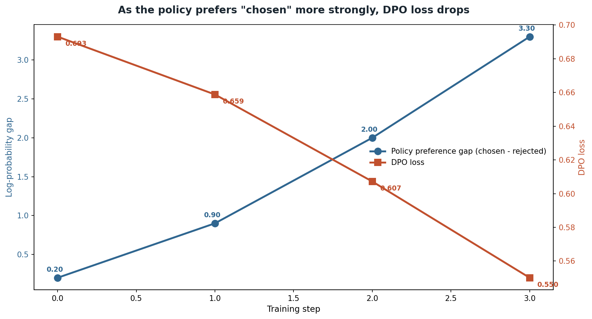

# The DPO loss

## What the code showed you

One preference pair: a good password-reset answer and a vague one. As a simulated policy's preference for the good answer grew from a small gap to a large one across four steps, the DPO loss fell from 0.693 to 0.550. No reward model, no reinforcement learning loop, just the preference pair and the reference model's own original scores.

## What's actually happening underneath that

*The exact values `topic_4_dpo_loss/main.py` prints.*

Before DPO, teaching a model to prefer better responses meant RLHF: train a separate reward model on human preference labels, then run a reinforcement learning loop (commonly PPO) to push the main model toward higher reward, all while trying not to drift too far from the original model. This works but is complex, often unstable, and expensive to tune.

DPO's insight, from the 2023 paper that gave it its name, is that this entire constrained optimization problem can be solved directly with one supervised-learning-style step, by comparing how much the current policy favors the chosen response over the rejected one against how much the original reference model favored it, scaled by a constant (beta). No separate reward model gets trained at any point. The loss in this code is the actual DPO loss, not a simplification.

## Where this sits next to GRPO

This project's main roadmap already covers GRPO, the algorithm behind DeepSeek-R1, in its fine-tuning stage. The two solve related but different problems, and current sources are specific about where each one wins:

DPO needs a labeled preference pair, decided by a person or another model, and works for subjective qualities: tone, helpfulness, style, anything without one single verifiably correct answer. GRPO needs an automatic, deterministic verifier and works best where correctness can be checked by a program: math, code, anything with a right answer a script can confirm. As of 2026, DPO remains the default preference-tuning method for most open-source and enterprise fine-tuning, while GRPO-style training dominates specifically for reasoning models trained against verifiable rewards.

## Resources, in the order I'd actually use them

**The original paper, genuinely readable**
- [Direct Preference Optimization: Your Language Model is Secretly a Reward Model](https://arxiv.org/abs/2305.18290) — won a NeurIPS 2023 outstanding paper award, and the abstract alone states the core idea cleanly: the reward-maximization problem can be solved exactly with a single stage of policy training.

**For the current 2026 comparison against GRPO specifically**
- [DPO vs GRPO vs RL for Reasoning](https://theorempath.com/topics/dpo-vs-grpo-vs-rl-reasoning) — lays out the practical rule used above directly: offline preference data and a subjective target favor DPO, a verifiable reward and a reasoning target favor GRPO.

**For the wider family DPO spawned**
- Search for IPO, SPO, KTO, SimPO, and ORPO if curious. All are variations on the same direct-optimization idea, each changing one assumption (how noise-sensitive the comparison is, whether a reward model is needed at all, how length bias gets handled). Not required reading for this stage, worth knowing the names exist.

## The one thing worth remembering

DPO's real contribution wasn't a new capability, RLHF could already do preference tuning. It was proving that the complex, unstable, three-stage pipeline could collapse into one stable supervised step. That's a strong example of a genuine simplification being as significant a contribution as a new capability would have been.
