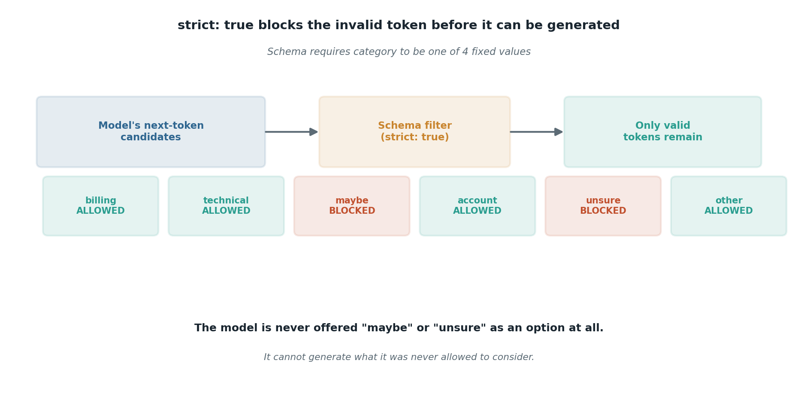

# Structured output and constrained decoding

## What the code showed you

A support ticket sent with a strict JSON schema attached. The response came back guaranteed to have a category from exactly four allowed values, an urgency level, and a summary, in that exact shape, every time.

## What's actually happening underneath that

Older approaches to getting JSON out of a model amounted to asking nicely and parsing whatever came back, hoping it matched. Constrained decoding works differently: the schema is handed to the model's decoding process itself, and at every single token, anything that would violate the schema is removed from consideration before the model picks its next token. The model is not avoiding invalid output through good behavior. It is never offered the option.

This project's specific setup: Groq supports two modes. Strict mode (`strict: true`) is true constrained decoding, a 100% guarantee, but only on a specific model list. Best-effort mode attempts compliance but can still occasionally produce invalid output or error. The code in this stage checked, and confirmed, that `openai/gpt-oss-120b`, this project's own default model, is on the strict-mode list. That was confirmed by reading Groq's own documentation, not assumed.

## Resources, in the order I'd actually use them

**The primary source, check this first for any model you actually use**
- [Groq Structured Outputs documentation](https://console.groq.com/docs/structured-outputs) — states directly which models support strict mode versus best-effort only. This list changes as Groq adds models, the same way the free-tier model list itself has already changed twice this year.

**For the general concept across providers**
- The structured-output research already done for this project's main curriculum (OpenAI, Anthropic, and Gemini all converged on native constrained decoding by early 2026) applies here too; Groq's implementation follows the same idea.

## The one thing worth remembering

A schema guarantees shape. It says nothing about whether the content is correct. That distinction gets its own full treatment in topic 3.
