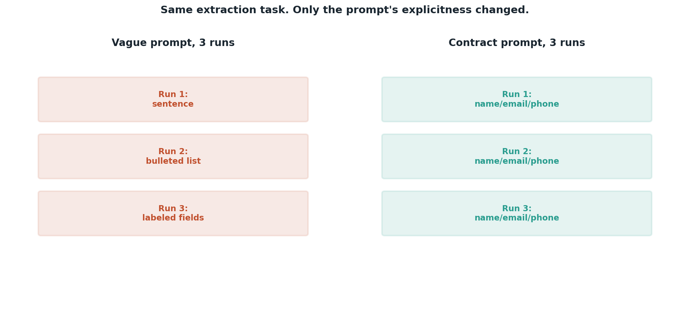

# Prompting as contracts

## What the code showed you

The same extraction task, asked three times with a vague prompt and three times with an explicit, contract-style prompt. The vague version's three answers likely differ in shape: a sentence once, a list another time, labeled fields a third. The contract version's three answers land in the same shape every time.

## What's actually happening underneath that

A vague prompt describes the task and leaves the model to infer what shape of answer would satisfy it. Since the model is sampling, not executing a fixed program, that inference can land differently each time, even when every individual answer would read as reasonable to a person. A contract prompt removes that inference step by stating the exact fields, the exact format, and what to do when a field is missing, directly in the prompt.

This matters specifically the moment something downstream parses the output automatically. A person can read any of the three vague answers and understand it. Code trying to extract a phone number from whichever shape happened to come back cannot.

## Resources, in the order I'd actually use them

**For the pattern itself, already established in this project's broader research**
- Structured prompting guidance from Anthropic's and OpenAI's own prompt engineering documentation covers this exact idea: specify the output format explicitly rather than describing the task and hoping the shape follows.

**For seeing this at production scale**
- Eugene Yan's patterns for building LLM-based systems (already referenced in this project's main roadmap, Stage 3) covers output contracts as one of several patterns nearly every shipped product ends up using.

## The one thing worth remembering

Reliability and correctness are different properties. A vague prompt can produce a correct answer every time and still be a worse prompt than a contract prompt, if the shape of that correct answer keeps changing.
