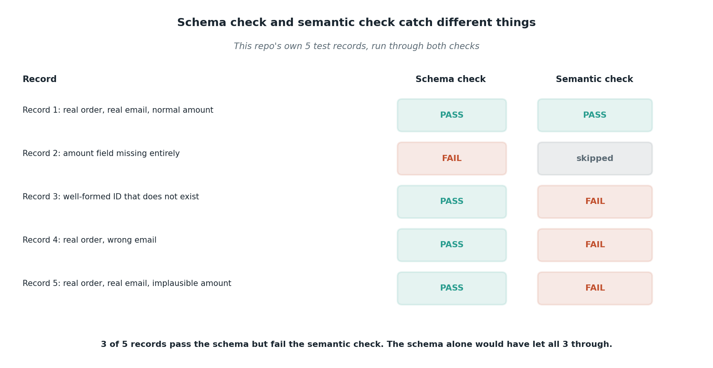

# Schema validation versus semantic validation

## What the code showed you

Five test records run through two separate checks. Three of the five passed the schema check (the shape was correct) but failed the semantic check (the content didn't hold up): an order ID that matched the expected pattern but didn't exist, an email that didn't match the account, an amount outside any plausible range. The schema alone would have waved all three through.

## What's actually happening underneath that

*These are the exact five records and results from this repo's own test suite, not illustrative numbers.*

A schema can only check the kind of thing a value is: is this a string, does it match this pattern, is this number present. It has no way to check whether that string refers to something real, because that requires looking the value up against actual data, not just inspecting its shape. `ORD-0001` and `ORD-4471` are equally valid as far as any schema is concerned. Only one of them is a real order in this toy example's records.

This is why the two checks in this code are kept as two distinct functions rather than one combined check. `schema_is_valid` runs first and is cheap, catching malformed input before anything else happens. `semantic_is_plausible` runs second and is where the actual business logic lives: lookups, range checks, cross-field consistency. Collapsing them into one function would make it easy to accidentally skip the semantic layer the moment the schema layer passes, which is exactly the mistake that lets bad data through in real systems.

## Resources, in the order I'd actually use them

**For the general principle**
- This exact distinction, schema guarantees shape and not correctness, was independently confirmed across every structured-output source already researched for this project. It shows up consistently enough across current sources to treat as settled, not just one team's opinion.

**For where this scales up**
- Pydantic's own documentation on validators (the `@field_validator` and `@model_validator` decorators) shows the production version of exactly this pattern: schema-level type checking combined with custom semantic checks in the same model definition.

## The one thing worth remembering

Never let "the schema passed" become "therefore the data is fine." A schema check and a semantic check answer two different questions, and skipping the second one is invisible until the wrong data has already been acted on.
