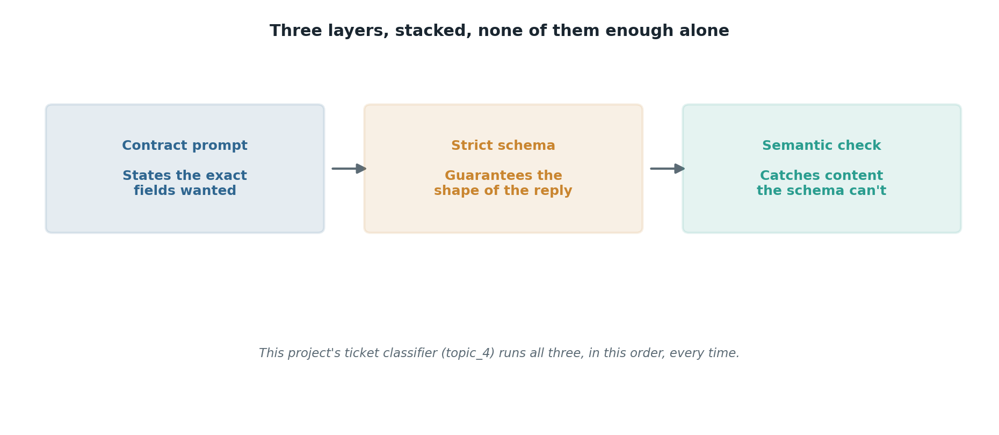

# The applied project: a real ticket classifier

## What the code showed you

Two real support tickets, each run through all three layers from this stage: a contract prompt stating the exact fields wanted, a strict schema guaranteeing the shape of the response, and a semantic sanity check afterward looking for content that doesn't add up, like a ticket mentioning being charged twice that didn't get classified as billing.

## What's actually happening underneath that

None of the three layers from this stage is sufficient by itself. A contract prompt without a schema still leaves room for the model to drift from the format on a bad day. A schema without a contract prompt still has to guess at field meaning from the schema alone, with no guidance on borderline cases. A schema without a semantic check will confidently accept a well-formed answer that contradicts the ticket it was supposed to describe.

The sanity check in this code is deliberately simple, a couple of keyword and consistency rules, not a trained model. That's the point: it exists to catch the kind of error a schema structurally cannot see, not to replace the classification itself. In a real system this layer grows more sophisticated over time, the same way an eval set grows, from real misclassifications a team actually observes.

## Resources, in the order I'd actually use them

**For how this generalizes beyond one toy classifier**
- The "Building Effective AI Agents" framing from this project's main roadmap applies even to something this small: a workflow (fixed steps, predictable) often beats reaching for more autonomy than the task needs. A ticket classifier with these three fixed layers is a workflow, not an agent, and that's the right level of complexity for this job.

## The one thing worth remembering

Every piece of this pipeline, the prompt, the schema, and the check, was built in isolation in topics 1 through 3 first. Combining already-understood pieces into a small real system is a different skill from understanding any one piece alone, and it's the skill this topic was built to practice.
