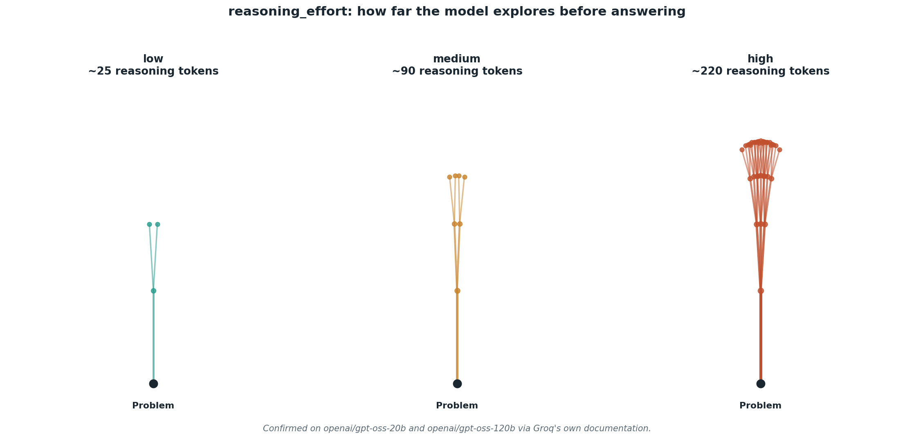

# reasoning_effort: the actual dial behind "a model that thinks"

## What the code showed you

The same tricky two-train word problem, sent three times with `reasoning_effort` set to low, medium, and high. Completion tokens and time taken should climb at each level, since the model is spending more of its response budget on internal reasoning before committing to an answer.

## What's actually happening underneath that

A reasoning model can generate internal reasoning tokens before its final answer, a kind of scratch space the model uses to work through a problem. `reasoning_effort` controls how much of that scratch space it's allowed to use. Confirmed directly against Groq's own documentation for this build: this parameter is supported specifically on `openai/gpt-oss-20b` and `openai/gpt-oss-120b`, this project's own default model, not a generic feature every model on Groq has.

The tradeoff is direct and unavoidable: more reasoning tokens means more cost and more latency, in exchange for a better shot at problems with multiple steps where an early mistake compounds. On a simple factual lookup, high effort buys nothing, since there's no multi-step reasoning for it to improve.

## Resources, in the order I'd actually use them

**The primary source, check this before relying on the parameter for any model**
- [Groq Reasoning documentation](https://console.groq.com/docs/reasoning) — states directly which models support `reasoning_effort` and what the valid values are. This is the same kind of check that mattered for Stage 3's structured output feature, and the same discipline applies here.

**For the underlying theory**
- Lilian Weng's *Why We Think*, already linked in this project's main roadmap (Stage 4), covers the theoretical case for why spending more compute at inference time, rather than only at training time, improves accuracy on reasoning-heavy tasks.

## The one thing worth remembering

Using high reasoning effort on every request is how a team quietly multiplies their latency and bill without improving most of their actual answers. The decision belongs per-task, not as a global default.
