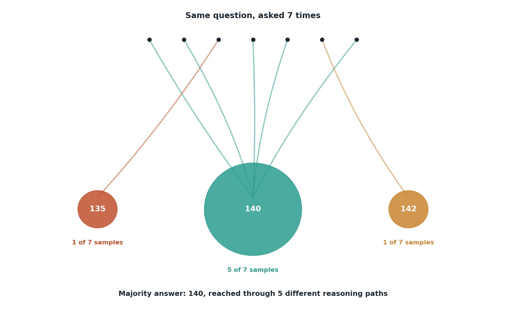

# Self-consistency

## What the code showed you

The same arithmetic word problem sampled 7 independent times at a high temperature. The correct answer, 140, should show up as the majority vote even if one or two samples land on a different, wrong number through a slightly different reasoning path.

## What's actually happening underneath that

Self-consistency needs no extra model and no verifier, just the ability to count. The idea: wrong answers to a well-defined problem tend to scatter across different wrong values, each one the result of a different small mistake, while the correct answer, reached through several different reasoning paths, keeps landing on the same number. Counting votes across several independent samples surfaces that pattern directly.

This only works on problems with one checkable correct answer, where "most common" is a meaningful signal. It does nothing useful for open-ended or subjective tasks, where there's no single answer for samples to converge toward in the first place.

## Resources, in the order I'd actually use them

**For the current framing and cost tradeoffs**
- Any of the test-time compute glossary sources referenced in this project's main roadmap (Stage 4) state the mechanism the same way this code demonstrated it: generate N, take the most common final answer, no separate verifier involved.

## The one thing worth remembering

A close vote split across several samples is itself a useful signal, not a failure. It tells you the problem is harder for the model than it looks, which a single sample would never have revealed.
