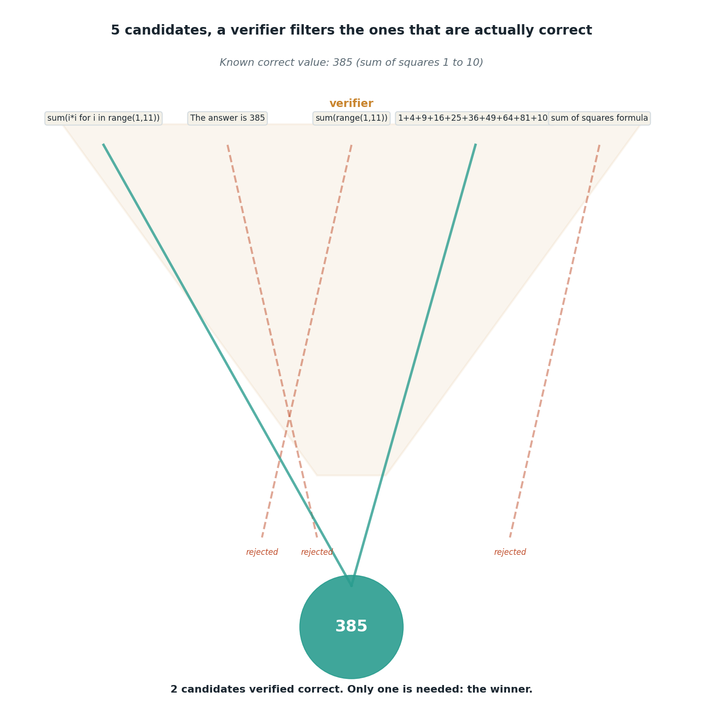

# Best-of-N with a real verifier

## What the code showed you

Five candidate Python expressions for the sum of squares from 1 to 10, each one actually evaluated against the known correct answer, 385. Two passed, three failed, including one that stated the correct number in prose without ever computing it, which the verifier correctly rejected.

## What's actually happening underneath that

Self-consistency counts votes. Best-of-N is different: a separate verifier scores each candidate independently, and the highest scorer wins, regardless of whether it was the most common answer. This matters specifically when correctness can be checked by a program rather than estimated by agreement, which is exactly the case here: a Python expression either evaluates to 385 or it doesn't, no voting required.

Building this verifier surfaced two real bugs worth knowing about, not just as a confession but because both are the kind of mistake this exact pattern invites. Blocking all Python builtins for safety also blocked `sum` and `range`, which meant the two most natural correct answers failed verification. And a regex that matched any digit sequence let "the answer is 385" pass as if it were a computed expression, when it never actually computed anything. Both were caught by testing the verifier against hand-written examples before trusting it, not by assuming the first version worked.

## Resources, in the order I'd actually use them

**For how this generalizes beyond a toy math problem**
- Any current test-time compute source (several already linked across this project) frames best-of-N the same way: it earns its cost specifically on tasks with a programmatic or reward-model verifier available, math and code being the clearest examples.

## The one thing worth remembering

A verifier is only as trustworthy as the tests run against it before it's trusted. "The code runs without an error" is a much weaker claim than "the code was checked against cases designed to break it," and this topic's own build is a direct example of why that distinction matters.
