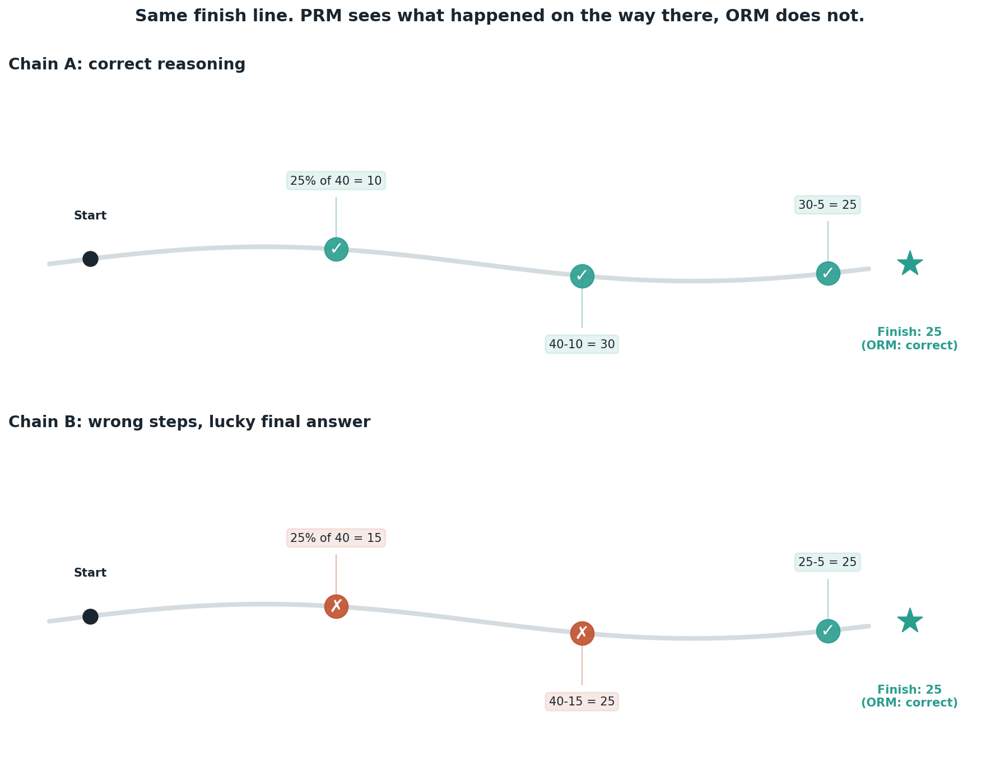

# Process reward models vs. outcome reward models

## What the code showed you

Two reasoning chains for the same discount problem. Chain A gets every step right. Chain B makes two separate errors that happen to cancel out, landing on the identical final answer. An outcome reward model scores both as correct, because it only ever looks at the last number. A process reward model correctly flags Chain B's two bad steps, because it checks the reasoning itself.

## What's actually happening underneath that

*The exact two chains and scores from this repo's own test suite.*

An outcome reward model (ORM) is the simpler of the two: check the final answer, done. A process reward model (PRM) scores every intermediate step against what that step should have produced. The difference only shows up on chains like Chain B, where errors cancel out. An ORM has structurally no way to see this, because by the time it looks, the errors have already disappeared into a correct-looking final number.

This is also the reason PRMs are what make tree search over reasoning paths possible. Searching a tree of partial reasoning chains means deciding which branches to keep exploring and which to prune, long before any branch has reached a final answer to check. An ORM has nothing to score at that point, since there's no final answer yet. A PRM can score each step as it's generated, which is exactly what let DeepSeek-style training and search-based inference methods work in the first place.

## Resources, in the order I'd actually use them

**For the current definitions, already confirmed in this project's own roadmap research**
- The test-time compute sources already linked in this project's main roadmap (Stage 4) define PRM and ORM the same way this code demonstrated them: an ORM scores the final answer only, a PRM scores each reasoning step.

## The one thing worth remembering

"Right answer" and "right reasoning" are different claims, and only one of the two reward models in this topic can tell them apart. Any system trusting an ORM alone is trusting that correct reasoning and correct answers always come bundled together, which Chain B shows is not guaranteed.
