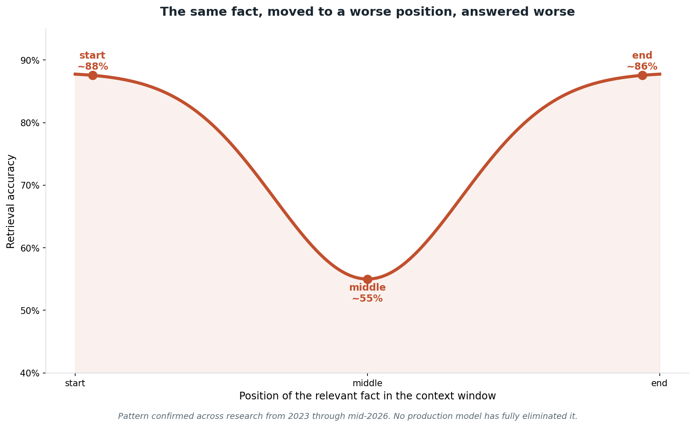

# Lost in the middle, and context rot

## What the code showed you

The exact same fact, the exact same question, asked three times with only the fact's position in a long context changed: start, middle, end. If the middle answer came back wrong or hedged while start and end were confident and correct, that's the pattern directly, on this project's own model, not a claim from a paper.

## What's actually happening underneath that

This has a name and a history. Liu et al.'s 2023 paper "Lost in the Middle: How Language Models Use Long Contexts" first documented a U-shaped performance curve: models are reliably better at using information placed at the very start (primacy bias) or the very end (recency bias) of their input, and significantly worse in the middle. Follow-up work (UW/MIT/Google, 2024) traced this to the model's own attention mechanism, finding a built-in U-shaped attention bias where early and late tokens get more attention regardless of actual relevance.

The current, broader term is "context rot," coined by Chroma's 2025 research after testing 18 frontier models: as total input length grows, performance erodes non-uniformly, not just at the middle position but from accumulating noise and semantically similar distractor content throughout. Confirmed as of mid-2026 across multiple independent research groups: no production model, including ones advertising million-token windows, has fully eliminated either effect. A bigger context window is not the same thing as a context window used evenly.

## Resources, in the order I'd actually use them

**The original paper, still the clearest statement of the finding**
- [Lost in the Middle: How Language Models Use Long Contexts](https://arxiv.org/abs/2307.03172) — the source of the U-curve and the primacy/recency framing used throughout this topic.

**For the mechanism behind it, and a partial fix**
- [Found in the Middle: Calibrating Positional Attention Bias](https://arxiv.org/pdf/2406.16008) — traces the bias to the model's own attention weights and proposes a calibration method that improved middle-position retrieval by up to 15 percentage points without retraining.

**For the current, broader framing**
- Chroma's Context Rot research (2025, 18 models tested) is the source of the term now used alongside "lost in the middle" for the noise-accumulation half of this problem, distinct from pure position bias.

## The practical takeaway, confirmed across current sources

Placing the most relevant document first and the second most relevant last, with everything else filling the middle, recovers a meaningful share of the accuracy lost to position bias. This is a real, current, cited mitigation, not a guess: it's the one piece of practical advice that shows up consistently from the original 2023 paper through 2026 follow-on research.

## The one thing worth remembering

"It fits in the context window" and "the model will actually use it well" are different claims. The first is about capacity. The second is about where in that capacity the information sits.
