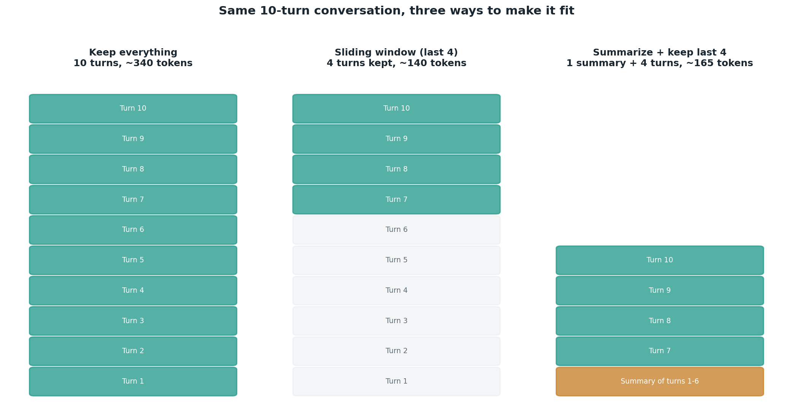

# Compaction strategies

## What the code showed you

A 10-turn conversation compacted three ways. Keeping everything costs the most tokens. A sliding window of the last 4 turns is cheapest but silently dropped the detail that the user had already switched from a work email to a personal one, information the very next turn still depended on. Summarizing the older turns into one message kept that fact alive in compressed form, at the cost of one extra model call.

## What's actually happening underneath that

A sliding window is purely mechanical: keep the last N turns, discard the rest, no model involved. It's free and instant, which makes it the right default when old turns genuinely stop mattering once the conversation moves on. Its failure mode is exactly what the code demonstrated: it has no concept of which old information is still load-bearing for what comes next, it just drops by age.

Summarization needs a real model call, since compressing meaning (not just selecting which turns to keep) is not something a list slice can do. The tradeoff is direct: one extra call per compaction, in exchange for keeping facts alive that a sliding window would have silently lost.

## Resources, in the order I'd actually use them

**For how this connects to context budgeting generally**
- This project's own Stage 1 first raised the context-budgeting problem (a conversation silently running out of room). This topic is the direct follow-up: once you know a budget exists, compaction is how you actually manage it as the conversation grows past that budget.

## The one thing worth remembering

Neither strategy is universally correct. The right one depends entirely on whether the information being dropped still matters to what the conversation does next, which is exactly the question this code's own example was built to make visible.
