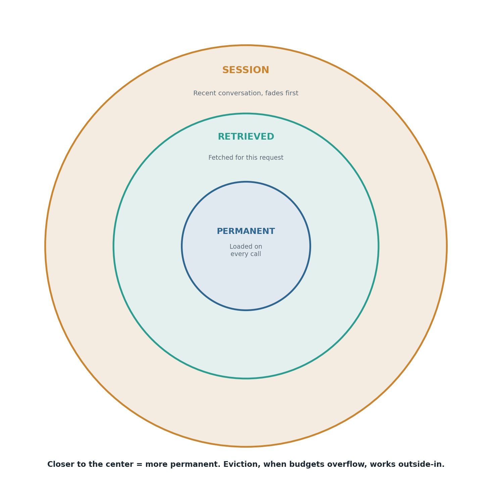

# Context tiers: permanent, retrieved, and session

## What the code showed you

A `ContextAssembler` with three separate budgets. When a fourth retrieved chunk pushed the retrieved tier over budget, the eviction that happened was plain first-in-first-out: the refund policy, the one fact actually relevant to this specific user's refund question, was evicted because it had been added first, while the irrelevant shipping and warranty policies survived because they'd been added more recently.

## What's actually happening underneath that

Not everything in a prompt has the same lifetime. The system prompt and core rules are permanent, loaded identically on every single call. Retrieved content is scoped to one specific request, relevant now and irrelevant the moment the topic changes. Session memory is shorter-lived still, useful for continuity within a conversation but not meant to persist past it. Treating all three as one undifferentiated block of text is what let Stage 1's original context-budgeting problem happen in the first place: nothing marked which part of the prompt was safe to lose first.

Giving each tier its own budget fixes the blind spot where one tier's growth silently crowds out another. It does not, by itself, fix a second and more interesting problem: this code's own eviction logic is purely chronological, oldest out first, with no sense of which piece of content is actually still relevant. The result was visible in this code's own run, not hypothetical: the most relevant fact was the one that got dropped.

## Resources, in the order I'd actually use them

**For where relevance-aware eviction actually gets solved**
- This is effectively a retrieval-ranking problem wearing a different hat. Stage 6's RAG work (reranking, relevance scoring) is the direct continuation: a context tier that evicts by relevance instead of by age needs exactly the ranking techniques that stage covers.

## The one thing worth remembering

A tiered budget is a structural improvement over one big undifferentiated context, but it is not automatically a smart one. This code's own test run proved that plainly: giving a tier a budget stops it from crowding out other tiers, but it says nothing about which of its own contents deserves to survive first.
