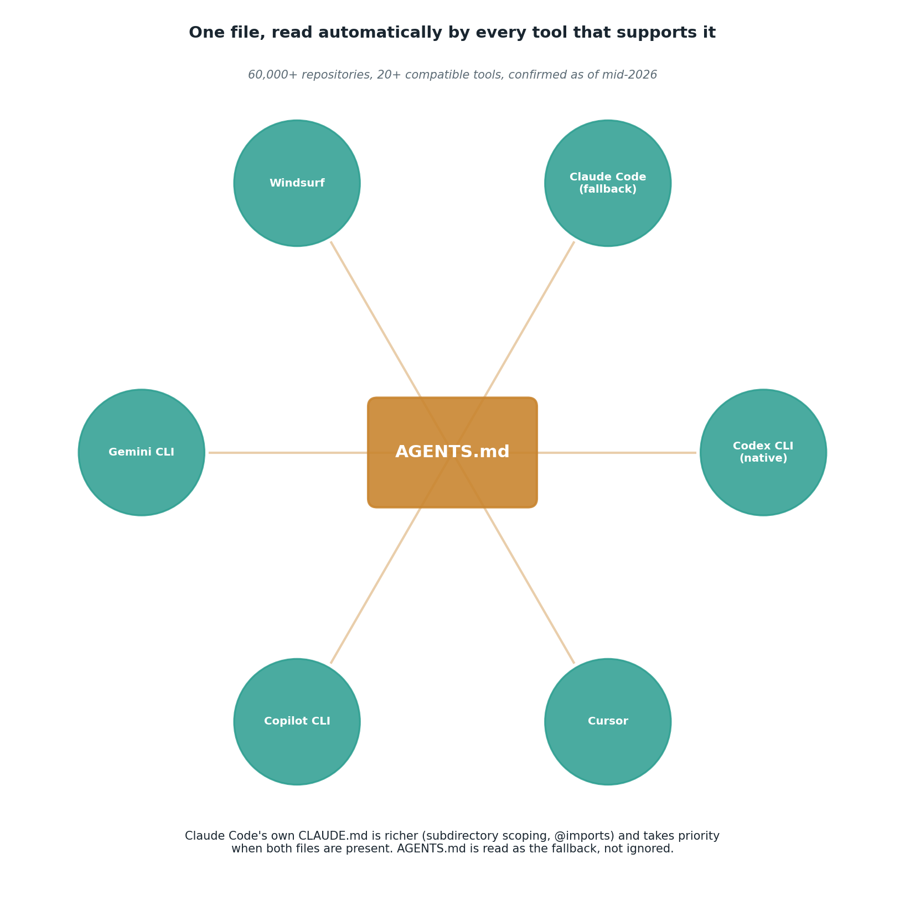

# AGENTS.md: persistent project context for coding agents

## What the code showed you

The same coding request, asked twice. Plain, it got a bare function. With a small AGENTS.md's conventions prepended (docstrings, type hints, catch specific exceptions, no bare `except:`, include a test), the response should have visibly followed those rules without being asked about them individually in the prompt itself.

## What's actually happening underneath that

Before this standard existed, every coding agent tool invented its own convention: `.cursorrules` for Cursor, `CLAUDE.md` for Claude Code, `.github/copilot-instructions.md` for Copilot. A team using more than one tool had to maintain the same project conventions written out separately, multiple times, with no guarantee they stayed in sync. AGENTS.md, originated by OpenAI and now under Linux Foundation governance, fixes this by being a plain Markdown file at the repo root that over 20 tools read natively, confirmed across more than 60,000 repositories as of mid-2026.

Claude Code specifically has its own richer format, CLAUDE.md, supporting features AGENTS.md doesn't specify, like subdirectory-scoped instructions and an `@file.md` import syntax for splitting large instruction sets into composable pieces. When both files exist in a repo, Claude Code reads CLAUDE.md; when only AGENTS.md exists, Claude Code reads that as a fallback rather than ignoring it. The practical move for a team using multiple tools: put shared conventions in AGENTS.md, and anything Claude Code specific in CLAUDE.md alongside it.

## Resources, in the order I'd actually use them

**For the format itself and a real example**
- [What Is AGENTS.md? How to Write One in 2026](https://www.tembo.io/blog/agents-md) — covers the open format directly, with the precedence rule (the AGENTS.md file closest to the edited file wins) and a full example.

**For how Claude Code specifically handles both files**
- [Claude Code and AGENTS.md: how AI agent instruction files work in 2026](https://www.eesel.ai/blog/claude-code-agents-md) — the decision diagram for which file gets read in which situation, directly relevant since this project's whole stack is built on Claude Code and Groq.

**For the cross-tool landscape and governance**
- [AGENTS.md as an Open Standard: Cross-Tool Portability Under Linux Foundation Governance](https://codex.danielvaughan.com/2026/04/07/agents-md-open-standard-cross-tool-portability) — the 60,000+ repository and 20+ tool figures used in this topic come from here.

## The one thing worth remembering

A convention stated once in a file read automatically beats the same convention retyped into every single prompt by hand, both for consistency and for the simple fact that nobody has to remember to do it. This is the same principle as Stage 3's contract prompts, moved from a single request to an entire project's persistent default.
