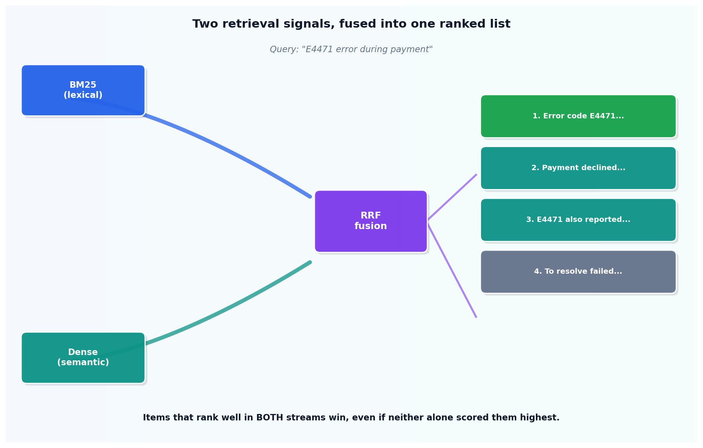

# Hybrid search

## What the code showed you

The query "E4471 error during payment" scored against six documents with BM25, with a simple dense-style cosine scorer, then fused with Reciprocal Rank Fusion. The two documents mentioning the exact error code E4471 came out on top of the fused ranking, which BM25 alone would have caught reliably (it rewards rare exact terms) but a pure dense search has no special mechanism for.

## What's actually happening underneath that

BM25 and dense vector search fail in complementary ways, confirmed consistently across every current 2026 source checked for this build. BM25 is precise on rare tokens, exact codes, names, and IDs, and blind to paraphrasing: ask about "resetting a password" when the document says "regaining account access" and BM25 finds nothing. Dense search is the opposite: strong on conceptual and paraphrased matches, weak on exact identifiers, since an error code's embedding carries little distinguishing signal compared to its literal string value.

Reciprocal Rank Fusion is the standard way to combine the two without needing to tune a weighting between them. Each retrieval method ranks the full candidate set separately. A document's fused score is the sum of 1/(k + rank) across every list it appears in, so a document that ranks well in both lists outscores one that ranks first in only one. This is confirmed as the 2026 default fusion method, not one option among many: current sources describe hybrid search plus RRF as the standard production pattern, with everything else (reranking, learned sparse retrieval) layered on top of it, not replacing it.

## Resources, in the order I'd actually use them

**For the current numbers and why hybrid wins**
- [Hybrid Search for RAG: Combining BM25 and Dense Vector Search (2026 Guide)](https://denser.ai/blog/hybrid-search-for-rag/) — the source of the WANDS benchmark figures: hybrid search reached 0.7497 NDCG, a 7.4% lift over either BM25 (0.6983) or dense alone (0.6953). Also covers a 2026 finding worth knowing: on financial documents, BM25 alone beat dense retrieval outright, challenging the assumption that semantic search always wins.

**For a from-scratch implementation walkthrough**
- Any current "BM25 from scratch" tutorial covers the same formula this code implements directly: term frequency, inverse document frequency, and the length-normalization terms k1 and b.

## The one thing worth remembering

Neither BM25 nor dense search is simply "better." They're blind to different things. Fusing them is not a compromise between two imperfect methods, it's covering one method's blind spot with the other's strength.
