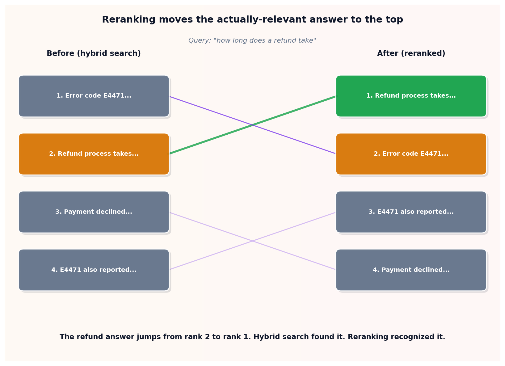

# Reranking

## What the code showed you

The top 4 results from hybrid search for "how long does a refund take," reranked by asking the model itself to score each one's relevance directly. If the refund-process document moved up from its hybrid-search rank, that's reranking catching an ordering mistake that the cheaper fusion signal missed.

## What's actually happening underneath that

Hybrid search is built for speed: it has to score an entire corpus, often millions of documents, so every signal it uses has to be cheap to compute at that scale. Reranking inverts the tradeoff. It only ever runs on the small handful of candidates hybrid search already narrowed things down to, which means it can afford a slower, more accurate judgment, in this code's case, asking the model directly how relevant each candidate is, a real and current pattern called LLM-as-reranker. A cross-encoder model, which jointly processes the query and passage together rather than comparing separately computed vectors, is the more common production choice, but the principle is identical: expensive judgment, cheap candidate pool.

The numbers worth remembering come directly from Anthropic's own Contextual Retrieval research. Their best setup, contextual embeddings combined with BM25, reached a 5.7% top-20 retrieval failure rate on its own. Adding a reranking stage on top of that cut it further to 1.9%, a 67% reduction. The same research reported a 49% failure rate with none of these techniques at all. Reranking is consistently described in current sources as the cheapest quality multiplier available in a RAG pipeline, specifically because it only costs extra compute on the few candidates that already survived the first pass.

## Resources, in the order I'd actually use them

**The primary source for the numbers used in this topic**
- Anthropic's Contextual Retrieval research is the origin of the 5.7%, 1.9%, and 49% figures cited above and in the code's own output. Worth reading directly rather than taking a secondhand summary of it.

**For the broader hybrid-plus-rerank pipeline this fits into**
- [Hybrid search and reranking for RAG: BM25, vectors, cross-encoders](https://wz-it.com/en/knowledge/ki/hybrid-search-reranking/) — covers the same Anthropic numbers alongside a practical three-stage pipeline: candidates from hybrid search, in bulk, narrowed by a cross-encoder reranker, with only the survivors reaching the model.

## The one thing worth remembering

Reranking only works because it's selective. Running an expensive relevance judgment on an entire corpus would be prohibitively slow. Running it on the four or five candidates hybrid search already found is cheap enough to do on every single query.
