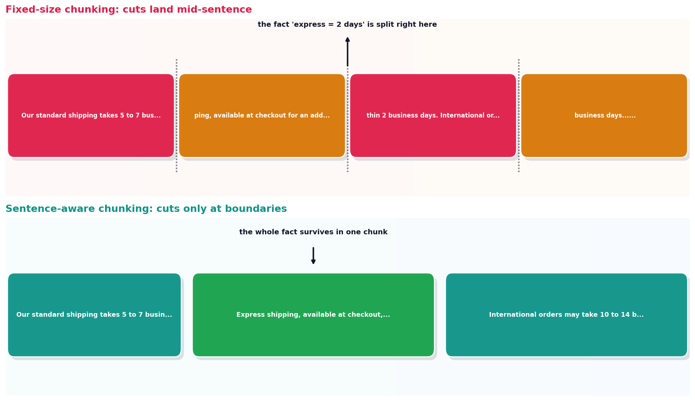

# Chunking strategies

## What the code showed you

The same shipping policy document, cut two ways at the same 80-character limit. Fixed-size chunking sliced the fact "express shipping delivers within 2 business days" across two separate chunks, right in the middle of the word "shipping." Sentence-aware chunking kept the entire sentence, and the entire fact, inside one chunk.

## What's actually happening underneath that

A fixed-size chunker has no model of the text it's cutting. It counts characters, and when the count hits the limit, it cuts, regardless of whether that lands between two sentences, in the middle of one, or mid-word. This is cheap and completely predictable, which is part of why it's still common, but it creates a specific failure mode visible in this code's own output: a retrieval system can find the exact right chunk and still fail to answer the question, because the chunk only contains half the fact.

Sentence-aware chunking fixes this directly by never allowing a cut to land inside a sentence, grouping complete sentences together up to the size limit instead. The tradeoff: chunks end up variable length rather than a clean fixed size, and the logic has to understand sentence boundaries, which gets genuinely harder on text with abbreviations, lists, or unusual punctuation than the simple period-and-space heuristic this code uses for a clear illustration.

## Resources, in the order I'd actually use them

**For the current state of chunking strategy as one of the four main 2026 RAG levers**
- [RAG Best Practices in 2026: Chunking, Reranking, Hybrid Search](https://www.callmissed.com/blog/rag-best-practices-2026) — names chunking strategy as one of the four levers nearly all RAG quality improvements come from, alongside hybrid retrieval, reranking, and the long-context tradeoff covered in this stage's final topic.

## The one thing worth remembering

A chunking strategy that's cheap to compute and a chunking strategy that preserves meaning are not automatically the same choice. This code's own output showed the gap directly: the fact survived under one strategy and didn't under the other, same document, same size limit.
