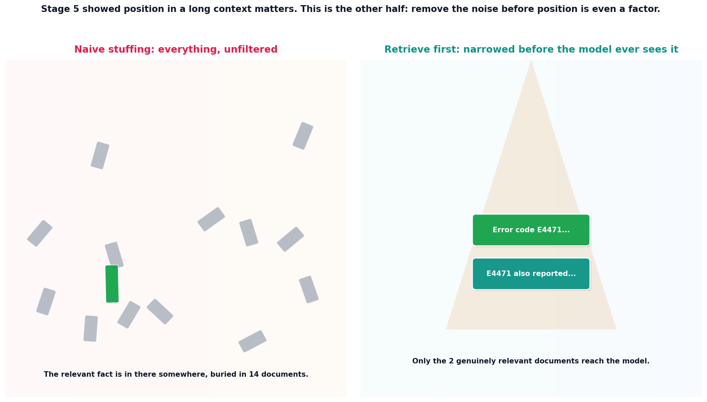

# RAG retrieves, long context refines

## What the code showed you

The same question asked against a 14-document corpus two ways: once by pasting the entire corpus into context raw, once by retrieving the top 2 relevant documents first and only passing those. Both approaches had access to the same underlying fact somewhere in the corpus. Only the amount of irrelevant material sitting between the model and that fact differed.

## What's actually happening underneath that

Frontier models now ship million-token context windows, which raises a reasonable question: if the whole knowledge base fits, why retrieve at all? The current 2026 consensus across every production RAG source checked for this build answers this directly: "RAG retrieves, long context refines." Use retrieval to narrow a large, noisy corpus down to a small set of genuinely relevant passages, then let the model's context window work with that narrowed, clean set. Skipping retrieval and relying on raw context size to find the needle itself runs directly into the problem Stage 5 demonstrated: a long, unfiltered context has far more room for a fact to land in a bad position and get missed, which research confirms persists even in models explicitly built for long context.

This is also why chunking (topic 3) and hybrid search plus reranking (topics 1 and 2) all feed into the same goal. None of them matter if the end result still gets diluted back into a massive, unfiltered context at the final step. Retrieval's job is specifically to keep that final context small and relevant, not just to exist somewhere earlier in the pipeline.

## Resources, in the order I'd actually use them

**For the current framing of this exact tradeoff**
- [RAG Best Practices in 2026: Chunking, Reranking, Hybrid Search](https://www.callmissed.com/blog/rag-best-practices-2026) — states the "RAG retrieves, long context refines" framing directly and explains why million-token windows change the RAG conversation without eliminating the need for retrieval.

**For the research this topic directly builds on**
- This project's own Stage 5 reading material on lost-in-the-middle and context rot is the other half of this exact argument. Worth rereading that topic's findings with this one's retrieval angle in mind.

## The one thing worth remembering

A bigger context window changes how much irrelevant material a model can survive having in front of it. It does not change whether irrelevant material hurts reliability. Retrieval is still the tool that removes the irrelevant material in the first place, regardless of how large the window gets.
