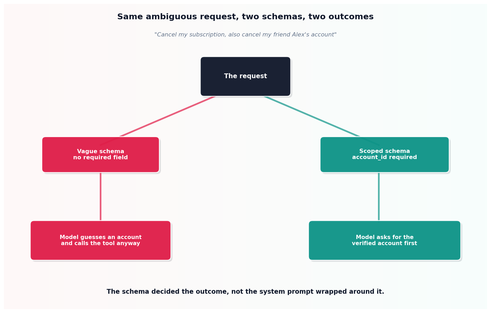

# Tool schema as the actual safety boundary

## What the code showed you

The identical ambiguous request, "cancel my subscription, also cancel my friend Alex's account," sent against two versions of the same tool. The vague schema, with no required account identifier, let the model guess at an account and call the tool anyway. The scoped schema, with `account_id` required and an explicit instruction not to infer it, gave the model a structural reason to ask for the missing information instead.

## What's actually happening underneath that

A system prompt saying "be careful with account changes" is one more piece of text the model weighs against everything else in its context, including a user who sounds confident and urgent. It can be outweighed. A required parameter cannot: without `account_id` present in the arguments, the call is structurally incomplete, and a well-built schema makes the model's own reasoning point toward asking for it rather than fabricating a plausible-looking value.

This is the same principle Stage 3 established for structured output generally, applied specifically to the moment a tool is about to take a real action rather than just return formatted text. The description field matters too, not just the required list: this topic's scoped version explicitly says "never infer the account from conversation context alone," turning a judgment call the model might get wrong into an explicit rule it's been told to follow.

## Resources, in the order I'd actually use them

**For the general principle this builds on**
- This project's own Stage 3 reading on structured output and constrained decoding covers the mechanism (schema enforcement during generation) this topic applies to tool calls specifically.

## The one thing worth remembering

If a tool can take a real, consequential action, ask what happens when the model is given ambiguous input, not just correct input. The schema's required fields and description are what decide whether ambiguity produces a clarifying question or a guess.
