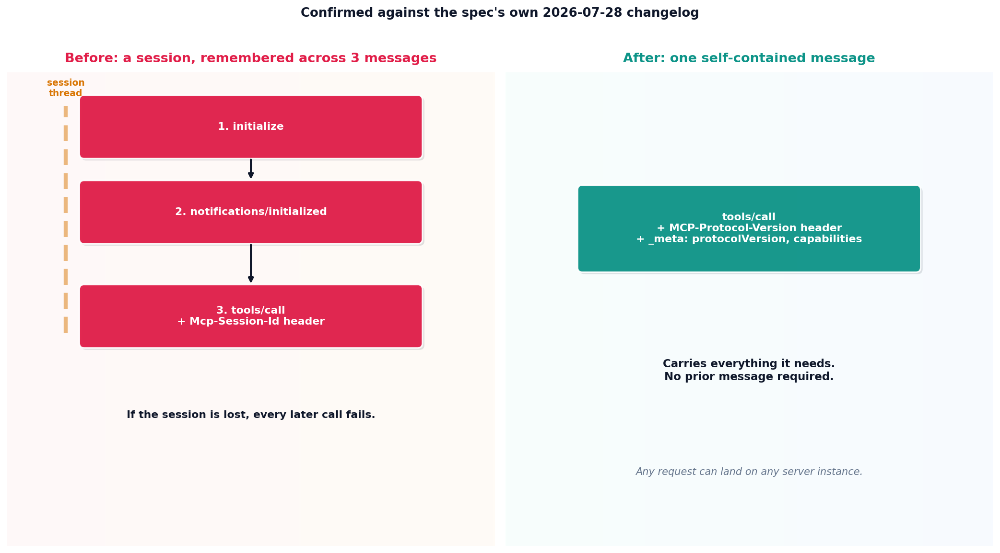

# MCP's stateless protocol

## What the code showed you

The old handshake: three separate messages, a session ID established on the second one, and a header required on every later call. The new shape: one self-contained message, carrying its own protocol version and capabilities, needing nothing established beforehand.

## What's actually happening underneath that

On July 28, 2026, MCP shipped its largest specification revision since launch, confirmed directly against the spec's own changelog and multiple independent migration guides for this build. The core change: the `initialize`/`initialized` handshake and the `Mcp-Session-Id` header are both removed. Every request under the new spec carries its own protocol version and client capabilities inside a `_meta` field, plus an `MCP-Protocol-Version` header, so no request depends on anything established by an earlier one.

The practical reason this matters: a stateful protocol needs sticky sessions, meaning every request from a given client has to land on the same server instance that holds its session state. A stateless protocol has no such requirement. Any request can land on any server instance, which is what lets an MCP server run behind an ordinary load balancer the same way any other HTTP service does, with no special session-affinity configuration. Confirmed as of this build: the maintainers describe this specifically as a scaling fix, not primarily a simplicity one, though it is both.

Worth knowing: as of the spec's July 28, 2026 publication, some documentation sites and SDK defaults lagged the actual spec version for a period, with versioning pages still listing the prior revision as "current" even after the new one shipped. This kind of gap between a spec publishing and tooling catching up is itself worth checking for directly, not assuming resolved by the time you read this.

## Resources, in the order I'd actually use them

**For the practical migration details**
- Current MCP server migration guides (several independently confirmed for this build) cover the specific breaking changes: `ping`, `logging/setLevel`, and `notifications/roots/list_changed` are removed outright, not just deprecated, and existing session-based code needs the handshake logic stripped entirely.

## The one thing worth remembering

"Stateless protocol" does not mean "stateless application." A server can still track whatever it needs across calls using its own storage, explicitly, as the project's own data rather than relying on the protocol to remember anything on its behalf.
