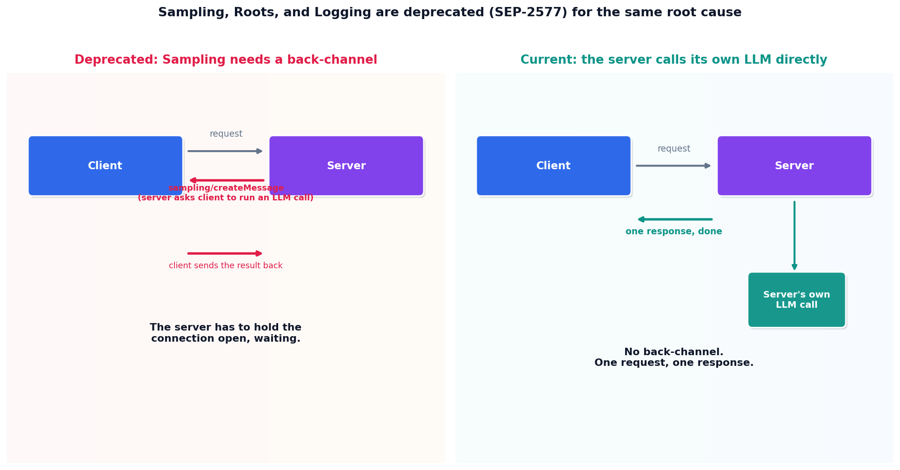

# What's deprecated, and why

## What the code showed you

The old Sampling pattern: a server pausing mid-request to ask the client to run an LLM call, then waiting for the result before it can finish responding. The new pattern: the server makes its own LLM call directly and returns a single, complete response. Same for Roots: instead of a client declaring filesystem access once per session, the working directory is passed as a plain argument on the one request that actually needs it.

## What's actually happening underneath that

Confirmed consistently across multiple independent migration guides for this build: the 2026-07-28 spec deprecates three primitives under SEP-2577, each given a twelve-month removal window rather than an immediate break. Roots, Sampling, and Logging share one root cause: all three required the server to send a request back to the client mid-call, a back-channel a now-stateless protocol has no standing infrastructure for. `ping`, `logging/setLevel`, and `notifications/roots/list_changed` are removed outright in the new spec, not just deprecated, since they depended directly on the removed session model.

The replacement pattern repeats across all three, and it's the same idea this topic's code demonstrates directly: stop relying on the server remembering something declared earlier, or asking the client to do work mid-call, and instead make the call directly or pass what's needed as an explicit argument on the request itself. Sampling becomes a direct LLM API call from the server's own code. Roots becomes a plain tool argument. Logging moves outside the protocol entirely, to stderr or OpenTelemetry, infrastructure that already existed and didn't need a protocol feature to begin with.

## Resources, in the order I'd actually use them

**For the specific SEP numbers and removal timeline**
- Current MCP migration guides covering SEP-2577 (the deprecation) and SEP-2575/SEP-2567 (the session removal) give the precise before-and-after wire formats this code's patterns are based on, including the twelve-month deprecation window before actual removal.

## The one thing worth remembering

Deprecated is advisory, not broken. A server built against the old primitives keeps working today. The window exists specifically so migration happens on a real timeline, not as an emergency the day the new spec publishes.
