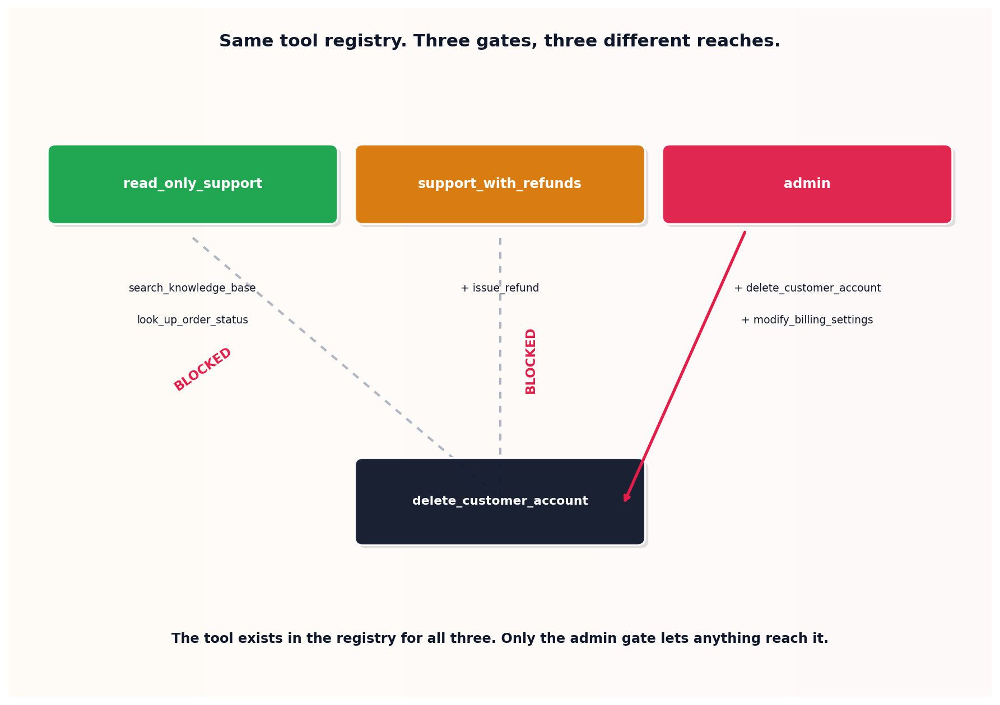

# Tool permission scoping

## What the code showed you

One tool registry containing a genuinely dangerous tool, `delete_customer_account`, tested against three different scopes. Both the read-only and refund-capable scopes correctly blocked the call. Only the admin scope let it through, and the tool itself never changed, only which scope could reach it.

## What's actually happening underneath that

A tool schema, covered in this stage's first topic, decides what a model can do once it has a tool available. Scoping is a separate, earlier question: which tools does this specific agent session even have in its list to begin with. These are genuinely different safety mechanisms, and conflating them is a real risk. A perfectly-designed `delete_customer_account` schema, with every required field correct, is still a risk if a read-only support bot has that tool in its available list at all. The fix isn't a better schema on that tool. It's not giving a read-only context that tool in the first place.

This is the same principle as giving a person only the system access their specific job requires, applied to an agent's tool list instead of a human's account permissions. The scope decision happens once, outside the conversation, which is exactly why it can't be negotiated around mid-conversation no matter how a message is phrased. An agent cannot talk its way into a tool that was never on its list.

## Resources, in the order I'd actually use them

**For how this connects to the next stage's agent safety work**
- This project's Stage 8 covers tool idempotency, a different and complementary safety property: idempotency limits the damage from a tool being called more than once, while scoping limits which tools can be called at all. A production agent needs both, not one instead of the other.

## The one thing worth remembering

A dangerous tool existing somewhere in a codebase is not automatically a risk. A dangerous tool being reachable from a context that shouldn't have it is. Scoping is the control that keeps those two facts from becoming the same thing.
