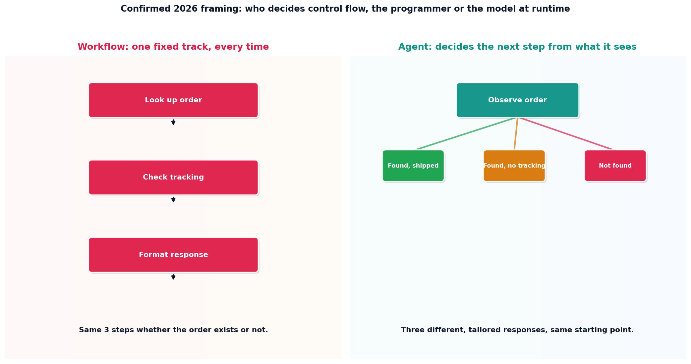

# Workflow vs. agent

## What the code showed you

The same order-lookup task, handled two ways, tested against an order that doesn't exist. The workflow's three fixed steps had no step written for that case, so it returned whatever its rigid sequence produces regardless. The agent, observing the same lookup result, decided a more useful response for that specific situation.

## What's actually happening underneath that

Confirmed as the current, unchanged 2026 framing across every source checked for this build: a workflow runs a fixed sequence the programmer hard-coded in advance. An agent decides its own next step at runtime, from what it actually observes. This is not a claim about which one is smarter. It's a claim about who decides control flow, and when that decision gets made, before the request ever arrives, or in response to it.

This matters directly for where to spend effort. A workflow's fixed steps are exhaustively testable: every input either matches a handled case or it doesn't, and you can enumerate every path. An agent's runtime decisions are not exhaustively testable the same way, which is exactly why this project's earlier evals work (Stage 3's golden-dataset discipline) matters more, not less, once agent autonomy enters a system.

## Resources, in the order I'd actually use them

**For the current state of this exact distinction**
- Multiple independent 2026 sources confirm the same framing used in this topic: the difference is architectural, not about model capability, and most production systems should default to a workflow, reaching for agent autonomy specifically where the input space is too varied to enumerate in advance.

## The one thing worth remembering

Agent autonomy is a cost, not a default upgrade. It buys flexibility on inputs you didn't anticipate, at the cost of losing the exhaustive testability a fixed workflow gives you for free. Spend that cost only where the flexibility is actually needed.
