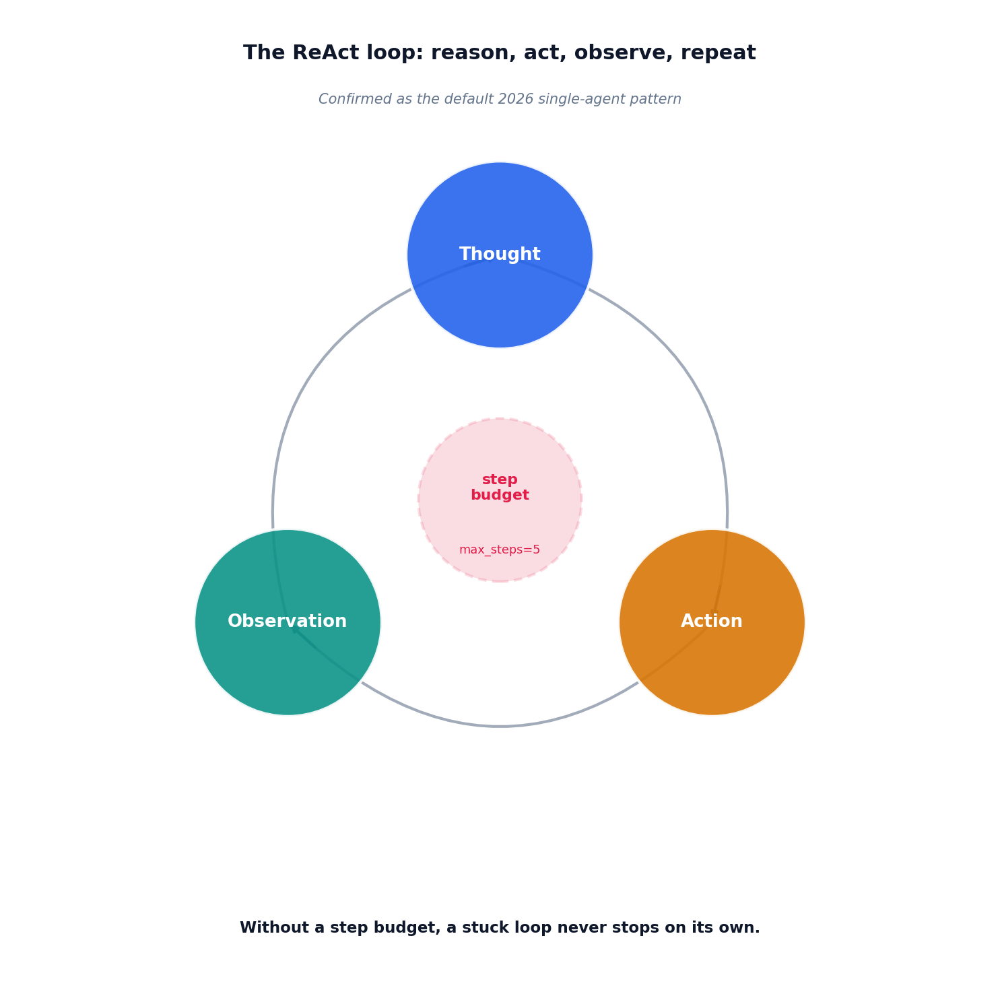

# The ReAct loop

## What the code showed you

A tool-use loop implemented from scratch: the model reasons about what to do, picks an action, a real Python function executes it, the result feeds back in, and the model reasons again, until it reaches a final answer or hits the step budget. A mock-scripted test confirmed the control flow directly: exactly two model calls, one tool executed correctly, the final answer extracted cleanly.

## What's actually happening underneath that

ReAct, named in a 2022 paper, is confirmed as the default single-agent pattern as of 2026, the thing most people mean when they say "agent" at all, according to multiple independent current sources. Most agent frameworks, LangGraph, LlamaIndex, the OpenAI Agents SDK among them, implement this exact loop as their default, which is why building it from scratch here is worth doing: once you've seen the actual mechanism, a framework's version of it is recognizable rather than a black box.

The step budget is not incidental. Current sources are specific that ReAct's known failure mode is long-horizon tasks, where a loop can stall or repeat without making progress, and the fix when that happens is almost never a better model, it's better architecture around the loop: a budget, a supervisor, or a different pattern entirely for that specific task shape.

## Resources, in the order I'd actually use them

**For the pattern's current standing and its known failure mode**
- Multiple 2026 sources confirm ReAct's strength (legibility: reading a trace tells you exactly what the agent reasoned, tried, and observed) and its known weakness (long-horizon tasks, where the loop can stall without a clear stopping signal).

**For where this project's roadmap picks this up again**
- This project's main roadmap Stage 10 covers agent cost control directly, including a real documented incident where a loop with no effective stopping mechanism ran for 11 days before anyone noticed. The step budget in this topic's code is the simplest version of the control that incident needed.

## The one thing worth remembering

A step budget is the cheapest, most important piece of architecture in this whole topic. Everything else about the loop can be elegant and still fail catastrophically without something that forces it to stop.
