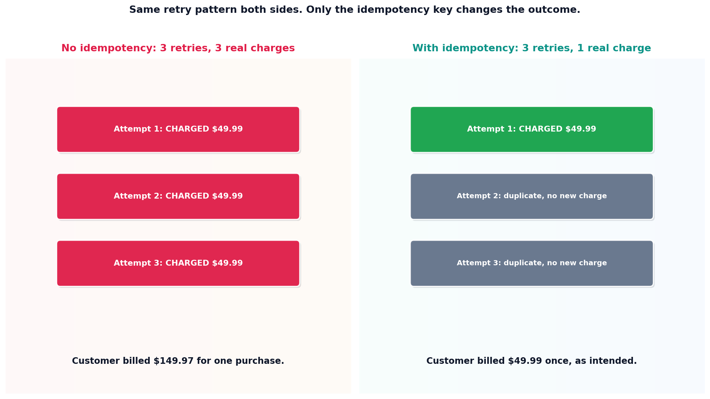

# Tool idempotency

## What the code showed you

The exact same retry pattern, three attempts simulating an agent retrying after a timeout, run against two versions of a payment tool. The naive version charged the customer three separate times, $149.97 for a $49.99 purchase. The idempotent version, using the same idempotency key on every attempt, charged once and correctly recognized the other two as duplicates.

## What's actually happening underneath that

Agents retry failed calls constantly: timeouts, transient errors, rate limits. That's normal, expected behavior, confirmed directly in this project's own main roadmap as a named Stage 8 concern. The actual problem was never the retry. It's a tool with no concept of "I have already done this exact thing." An idempotency key fixes this directly: the caller generates one unique key per logical action, attaches it to every attempt of that action, and the tool checks whether that key has already been processed before doing anything.

This matters most specifically on tools with a real-world side effect: sending money, sending email, writing to a system outside the agent's own database. Read-only tools, like the search and lookup tools in this stage's other topics, rarely need this property at all, since calling them twice produces no harm beyond a wasted API call. The property is required exactly where a duplicate call does real damage.

## Resources, in the order I'd actually use them

**For how this connects to this stage's other safety topic**
- Stage 7's tool permission scoping covers a different, complementary property: scoping limits which tools a context can call at all, while idempotency limits the damage from a tool being called more than once. A production system needs both, since neither one covers the other's failure mode.

## The one thing worth remembering

Before adding any tool with a real-world side effect to an agent's available list, ask whether it's safe to call twice with identical input. If the honest answer is no, that's the thing to fix before the tool goes anywhere near an agent, not something to hope never happens.
