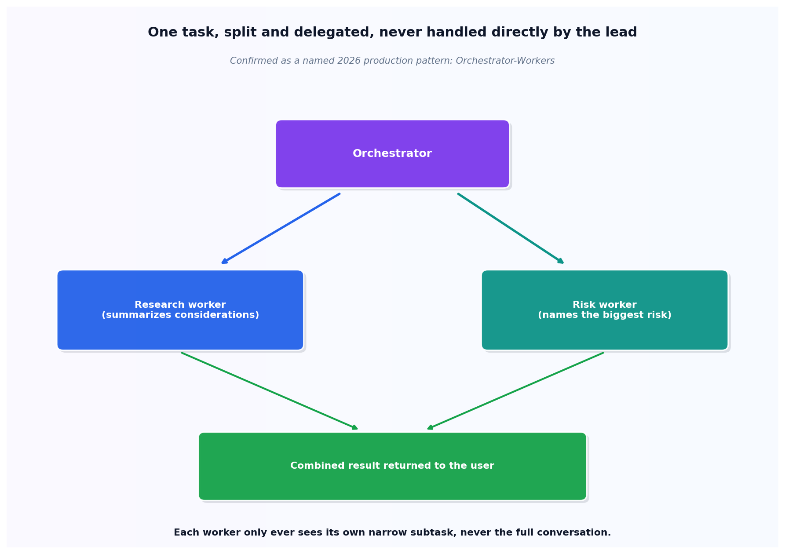

# Orchestrator-Workers

## What the code showed you

A single task, "should a small team self-host an open-weight model," split by an orchestrator into two subtasks: one for a research worker, one for a risk-analysis worker. The orchestrator itself never did the research or the risk analysis. Its entire job was deciding how to split the work and combining what came back.

## What's actually happening underneath that

Orchestrator-Workers is confirmed as one of the small, named set of multi-agent patterns that actually carry production systems in 2026, not one option among dozens. The structural benefit over a single ReAct agent handling everything in one loop: each worker here only ever sees its own narrow subtask, never the full conversation or the other worker's context. That keeps each worker's prompt focused, and when something goes wrong, the failure is isolated to one worker's narrow responsibility rather than tangled into one agent's entire reasoning trace.

LangGraph is confirmed as the dominant 2026 framework implementing this exact pattern as an explicit graph: a node for each worker, conditional edges for the orchestrator's routing decision, compiled into a runnable. What this topic built by hand, with plain Python and this project's own LLMClient, is the identical coordination logic a framework wraps in more structure. Hand-rolling it here makes the actual mechanism visible before reaching for a framework's abstraction over it.

## Resources, in the order I'd actually use them

**For the current landscape of named multi-agent patterns**
- Current 2026 sources are consistent that the field has converged on a small set of named patterns, ReAct, plan-and-execute, reflection, routing, and orchestrator-workers among them, rather than ad hoc multi-agent sprawl. Picking a known pattern deliberately, rather than reaching for "multi-agent systems" without a specific topology in mind, is the repeated advice across every source checked for this build.

## The one thing worth remembering

The orchestrator's value is entirely in what it doesn't do. The moment an orchestrator starts doing research or risk analysis itself instead of delegating, the pattern has collapsed back into one agent with extra steps, losing the isolation that made the pattern worth using in the first place.
