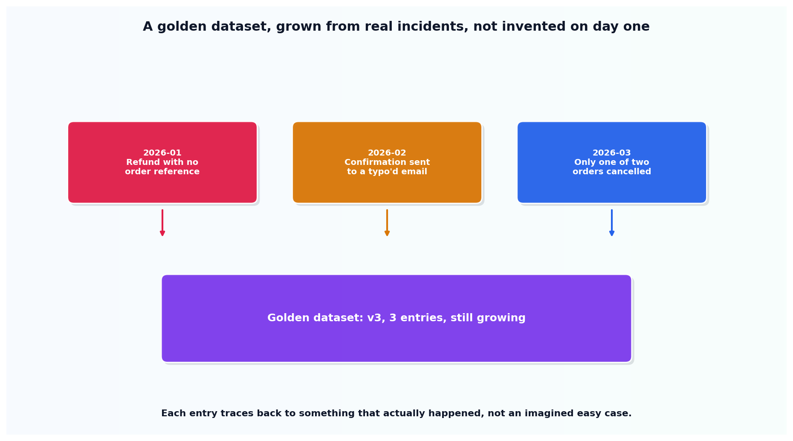

# The golden dataset, built from real incidents

## What the code showed you

Three entries, each one modeled on a specific, real kind of production failure: a refund processed with no order reference, a confirmation sent to a mistyped email, only one of two requested cancellations actually completed. Each entry traces back to a named incident, and the dataset's version number climbs with each addition.

## What's actually happening underneath that

A golden dataset built from twenty easy, invented questions proves almost nothing about real-world reliability, a problem this project's earlier work (Stage 3's eval ladder discussion) already named. The fix confirmed across current sources is specific: pull from actual logged production failures, especially ones that already went wrong once, and treat the resulting set as living and growing, never frozen after an initial afternoon of writing test cases.

The reason this is harder than writing clean examples, and also why it's worth the effort: a dataset made of real failures tests exactly the failure modes that actually occurred, not the ones someone imagined in advance. The version tracking in this topic's code isn't decoration either. It's the mechanism that makes "still growing" a checkable fact rather than an intention nobody verifies.

## Resources, in the order I'd actually use them

**For how this connects to this project's earlier eval work**
- This project's own Stage 3 reading on testing a probabilistic feature covers the four-level eval ladder (smoke tests, property assertions, LLM-as-judge, human review) this dataset is built to feed into. A golden dataset is the fuel; the ladder is what actually runs against it.

## The one thing worth remembering

A golden dataset that stops growing is testing against a version of production traffic that stopped existing the day someone decided it was "done." The version number in this topic's code exists specifically to make that staleness visible instead of silent.
