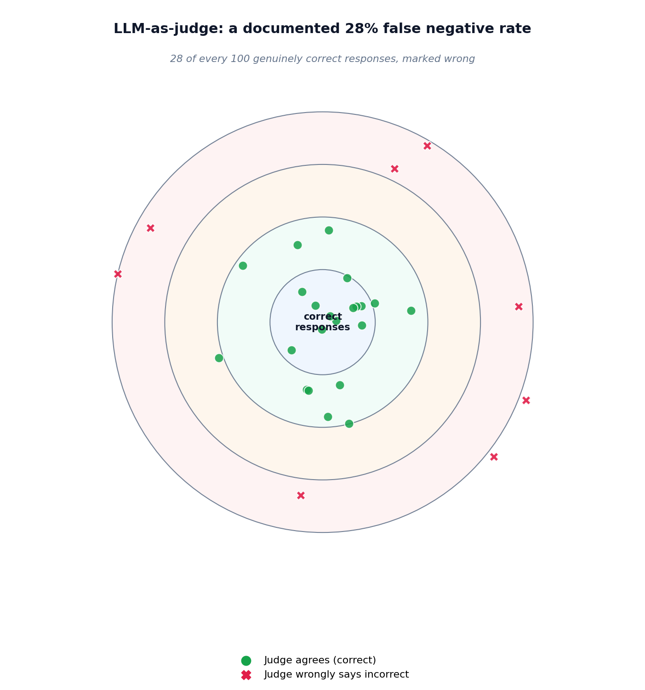

# LLM-as-judge, calibrated against real disagreement

## What the code showed you

Four responses with known human labels, judged by the model itself. Any disagreement between the judge's label and the human label in that run is the documented statistic showing up directly, not staying an abstract number cited in a report.

## What's actually happening underneath that

A 2026 harness-engineering survey reports a 28% false negative rate for automated LLM-as-judge evaluation, confirmed directly for this build: the judge marks genuinely correct responses as wrong often enough that this is treated as a known, documented limitation, not an edge case. This matters specifically because LLM-as-judge is attractive precisely where it's riskiest to rely on alone: it scales to volumes human review can't match, which makes it tempting to treat as a complete replacement rather than one signal among several.

Current practice is explicit about the fix: combine automated judging with a human-verified test set, never treat the judge's verdict as the full picture on its own. The property-assertion layer from this project's established eval ladder (Stage 3) exists partly for this reason too: catching what a deterministic check can verify directly removes exactly the cases where a judge's probabilistic judgment would otherwise be the only signal available.

## Resources, in the order I'd actually use them

**For the source of the 28% figure used in this topic**
- A 2026 survey formalizing harness engineering as a discipline (synthesizing two related surveys on the topic) reports this false negative rate directly as part of a broader "Verification" layer in its proposed taxonomy for evaluating language model systems.

## The one thing worth remembering

A judge that agrees with you most of the time is not the same as a judge you can trust without checking. 28 wrong verdicts in 100 is common enough that any single disagreement in a small test like this one is expected, not a sign something is broken.
