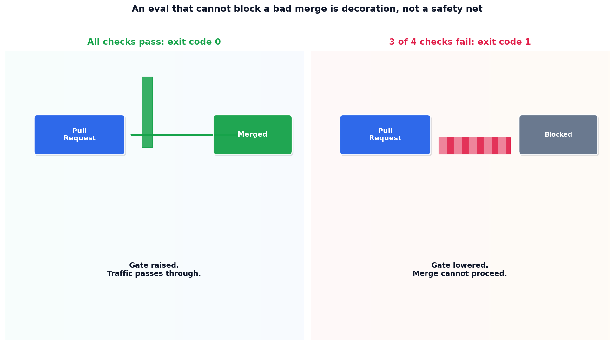

# The eval that actually blocks a merge

## What the code showed you

Four test cases run through a real property-check suite. Three failed. The process's actual exit code, confirmed by checking the shell's own exit status after the script ran, was 1, not just a printed message claiming failure. That's the literal mechanism a CI pipeline uses to decide whether a merge can proceed.

## What's actually happening underneath that

This project's own main roadmap states the principle this topic builds directly: an eval that cannot block a bad merge is decoration, not a safety net. A report nobody reads, a dashboard nobody checks, a Slack message nobody acts on, none of these actually stop a regression from shipping. A non-zero exit code, wired into a CI pipeline's pass/fail check, does. There's no middle ground that's almost as good.

The property checks themselves are the same deterministic layer established in Stage 3's eval ladder: is the category one of the allowed values, is the summary under the length limit, nothing probabilistic or judgment-based. This is deliberate. The fastest, cheapest layer of an eval suite should be the one that actually gates the merge, with LLM-as-judge and human review reserved for the harder, more expensive layers above it.

## Resources, in the order I'd actually use them

**For where this fits in the full eval ladder**
- This project's Stage 3 reading on testing a probabilistic feature lays out all four levels (smoke tests, property assertions, LLM-as-judge, human review) this topic's gate sits at the base of.

## The one thing worth remembering

The difference between "we have evals" and "evals that matter" is one line: does a failure actually stop the merge, or does it just get logged somewhere. This topic's own code proved the difference concretely by checking the real exit code the shell received, not just trusting the printed output.
