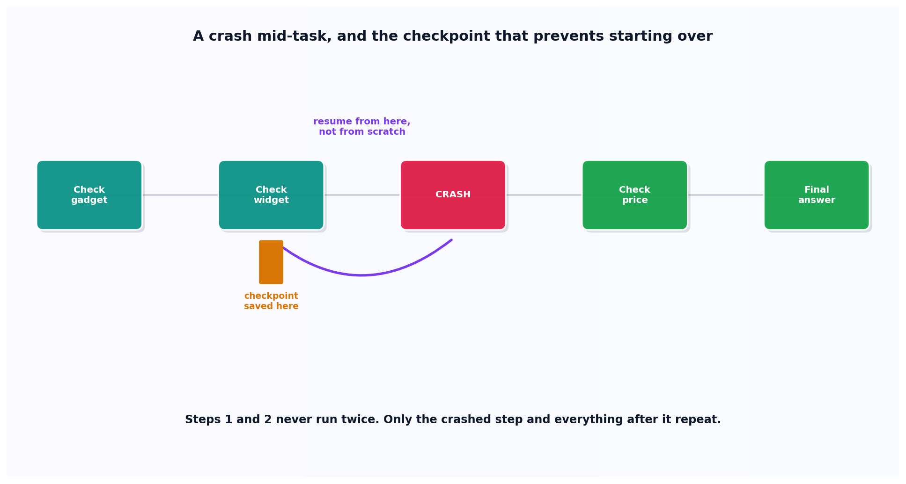

# Checkpoint and recovery

## What the code showed you

A scripted agent task that crashes at step 3. The first run dies there, with its progress saved. The second run resumed from exactly that point, never redoing the first two completed steps, and finished the task. The first version of this code actually hit the same simulated crash twice before being fixed, since the crash wasn't marked as a one-time event, a real bug caught by running it, not assumed to work.

## What's actually happening underneath that

Long-horizon agent execution needs a way to recover from a crash partway through, confirmed as an active 2026 research area, with frameworks explicitly built around recording checkpoints of agent state so execution can resume rather than restart. Without this, a crash means one of two bad outcomes: starting the entire task over, repeating every already-completed action including any with real side effects, or losing the task's progress entirely.

This is the structural fix for the failure class behind the 11-day, $47,000 runaway agent incident already referenced in this project's main roadmap. A process with no checkpoint and no way to report its own progress gives nothing external a way to distinguish "still working correctly" from "stuck looping forever." A checkpoint is specifically what gives an outside system, a monitoring dashboard, an operator, another process, the ability to inspect exactly how far an agent actually got, rather than trusting that it's fine because it hasn't crashed loudly yet.

## Resources, in the order I'd actually use them

**For the current research on this exact problem**
- 2026 research on recoverable execution frameworks for long-horizon LLM agents confirms this as an active area, with runtime systems that record aligned checkpoints of agent context and environment state specifically so execution can return to an earlier point and resume with information from previous attempts, rather than treating a crash as total task failure.

## The one thing worth remembering

A checkpoint only has value if something actually reads it before deciding whether to restart from scratch. Saving state nobody checks is the same as not saving it. The second run in this topic's code only worked correctly because it explicitly loaded the checkpoint first.
