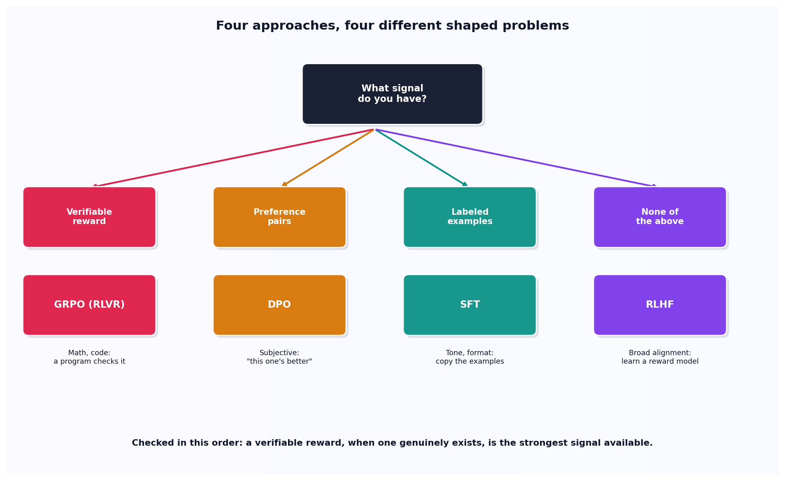

# When SFT, DPO, RLHF, or GRPO actually applies

## What the code showed you

Five realistic scenarios, each routed to a different approach by one decision function: a support bot's tone to SFT, a conciseness preference to DPO, a math-solving task to GRPO, broad helpfulness alignment to RLHF, and a brand new product with no data at all to "collect data first."

## What's actually happening underneath that

These four approaches exist because they solve four differently-shaped problems, not because one superseded the others over time. SFT teaches tone and format by showing correct examples to copy, nothing about judgment between competing options. DPO (built in this project's Stage 2) teaches a preference between two responses when there's no single verifiably correct answer, just "this one is better." GRPO, built in this stage's next topic, applies specifically when a program can check correctness directly, math and code being the clearest cases. RLHF is the remaining option when none of the other three signals exist but the problem still needs aligning, at the cost of training a separate learned reward model.

The verifiable-reward check runs first in this topic's code deliberately. When a program can check correctness directly, that signal is stronger than any human preference judgment, which is exactly why GRPO-style training dominates math and code benchmarks, and exactly why it offers nothing for anything subjective, there being no program that can check whether a joke landed or a tone felt right.

## Resources, in the order I'd actually use them

**For where the first three approaches get their actual implementations in this project**
- This project's own Stage 2 built the real DPO loss on a worked preference pair. This stage's topic 3 builds the real GRPO loss. Together with this topic's decision layer, all three pieces, when to use each and how each one actually computes its loss, are now in one place.

## The one thing worth remembering

Asking "which fine-tuning method is best" is the wrong question before asking "what kind of signal do I actually have." The four approaches aren't ranked by quality, they're matched to four different data situations, and using the wrong one for the signal available wastes the effort regardless of which one is chosen.
