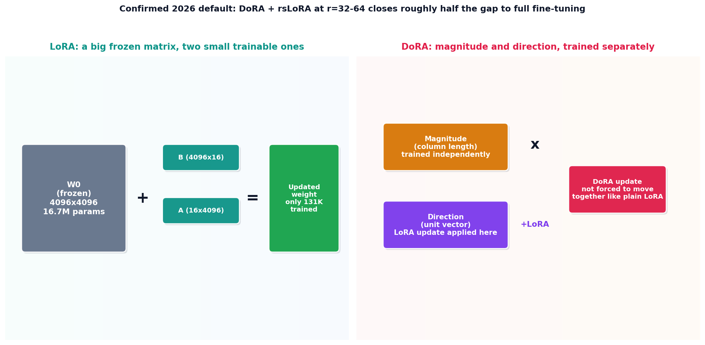

# LoRA and DoRA, the real math

## What the code showed you

At a realistic layer size, 4096x4096, full fine-tuning needs 16.7 million trainable parameters. LoRA at rank 16 needs only 131,072, a 99.2% reduction, not the 50% a smaller illustrative example would suggest. DoRA, applied to the identical frozen weights and identical low-rank update matrices, produced a measurably different result, because it trains magnitude and direction as separate parameters instead of one coupled update.

## What's actually happening underneath that

LoRA's core idea: the update a weight matrix needs during fine-tuning has a low "intrinsic rank," meaning it can be well-approximated by the product of two much smaller matrices, A and B, rather than requiring a full update to every single weight. The original matrix stays completely frozen. Only A and B ever get trained, which is where the dramatic parameter reduction comes from, and why the reduction gets more extreme, not less, as the original matrix gets larger.

DoRA, confirmed as the 2026 practical default successor, fixes a specific structural limitation in plain LoRA: a weight column's magnitude (how long the vector is) and direction (which way it points) are forced to move together in a fixed ratio under standard LoRA, because the single low-rank update affects both simultaneously. Full fine-tuning has no such constraint. DoRA removes it by decomposing the original weight into magnitude and direction first, then applying the LoRA update only to direction while magnitude trains as its own independent parameter. Confirmed current guidance: DoRA stacked with rsLoRA scaling, at rank 32 to 64, closes roughly half the remaining gap between LoRA and full fine-tuning, at only 5 to 10% more memory, with zero added cost at inference once the update is merged back into the base weights.

## Resources, in the order I'd actually use them

**For the original LoRA hypothesis**
- Hu et al., 2022, the paper introducing LoRA, builds on the finding that fine-tuning updates exhibit a surprisingly low intrinsic dimensionality, which is the mathematical justification for why a low-rank approximation works at all rather than losing meaningful capability.

**For DoRA's specific fix and its current standing**
- DoRA (NVIDIA, ICML 2024 Oral, confirmed as the 2026 default) is explicit about the magnitude-direction coupling problem in plain LoRA and demonstrates closing roughly half the gap to full fine-tuning as a direct result of decoupling the two.

## The one thing worth remembering

The 50% reduction in this topic's small 64x64 example is the least impressive case, not a representative one. Real model layers are far larger, and the relationship is the opposite of what intuition suggests: bigger matrices get more dramatic savings from the same rank, not less.
