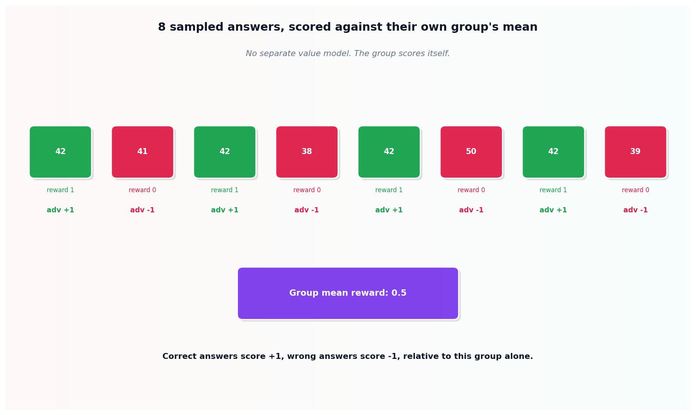

# The GRPO loss

## What the code showed you

Eight sampled answers to the same math problem, half correct and half wrong, scored entirely against their own group's mean: correct answers got an advantage of exactly +1, wrong answers exactly -1, with no separate model estimating an expected reward anywhere in the computation. A clipping term then correctly bounded one policy ratio (1.5) that would otherwise have pushed its update too far.

## What's actually happening underneath that

GRPO is the algorithm that made RLVR (Reinforcement Learning with Verifiable Rewards) practical at scale, confirmed directly in this project's main roadmap as the training method behind DeepSeek-R1's documented result: 15.6% to 77.9% on AIME 2024 math problems, using only GRPO and a verifiable reward, with zero supervised fine-tuning. The verifiable reward itself is the easy part conceptually, a program checking whether an answer matches the known correct one, exactly the kind of deterministic check this project's Stage 3 already established as the cheapest, most trustworthy layer of any eval pipeline.

What GRPO specifically removes is the separate value model that PPO-style reinforcement learning normally trains alongside the policy, to estimate expected reward. GRPO replaces that entirely with the group's own mean and standard deviation: generate several responses to the same prompt, score each with the verifier, and compare each one's reward only to its own group's average. This is a direct, measurable reduction in memory and complexity, since there's no second model's parameters and optimizer state to hold alongside the policy being trained. The clipping term carried over from PPO still does its job unchanged: bounding how far a single update can push the policy, regardless of how extreme one sample's advantage or ratio happens to be.

## Resources, in the order I'd actually use them

**For the documented result this topic's math is modeling**
- DeepSeek-R1-Zero's published training details are the source of the 15.6% to 77.9% AIME 2024 figure used throughout this topic, confirmed as trained with GRPO and a verifiable reward alone, no supervised fine-tuning stage at all.

**For where this fits against DPO**
- This project's Stage 2 built DPO's loss on a single preference pair. The two algorithms solve genuinely different problems: DPO needs a labeled pair, decided by a person or another model. GRPO needs a verifier that can check correctness automatically, which is why GRPO dominates specifically where DPO structurally cannot: math and code, where a program can judge the answer directly.

## The one thing worth remembering

Nobody wrote code telling DeepSeek-R1-Zero to reason step by step. The training loop discovered, purely through this group-relative scoring mechanism, that longer reasoning chains tended to land on the correct answer more often, which produced a better average advantage, which the loop then reinforced. The behavior emerged from the incentive structure, not from an instruction.
