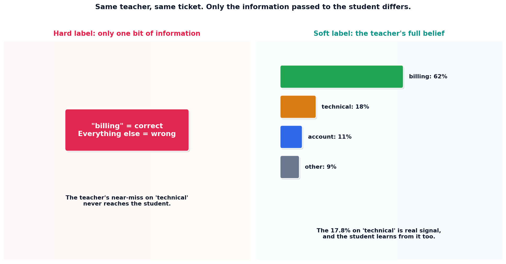

# Knowledge distillation

## What the code showed you

A teacher model's full distribution over four categories for one support ticket: 62.1% billing, 17.8% technical, 10.8% account, 9.3% other. A hard-label loss only ever sees whether "billing" was right. A soft-label distillation loss carries the entire shape of that distribution into the student's training signal, including the teacher's genuine, informative near-miss on "technical."

## What's actually happening underneath that

Knowledge distillation trains a smaller student model to mimic a larger teacher's full probability distribution over possible answers, not just the teacher's single final answer, confirmed directly in this project's main roadmap as the fourth technique belonging alongside quantization for making a large model's quality deployable at a fraction of the cost. The mechanism this topic's code demonstrates directly: cross-entropy against the teacher's complete probability vector, rather than against a one-hot label that only marks a single correct class.

The practical reason this works better than training a small model from scratch on the same labeled data: the teacher's "wrong" probabilities aren't noise, they're informative. A teacher that puts real probability mass on "technical" alongside "billing" is encoding something true about this specific ticket, that it genuinely touches both categories, information a hard label throws away entirely.

## Resources, in the order I'd actually use them

**For the real limitation, already established in this project's main roadmap**
- A distilled model inherits the teacher's blind spots and genuinely cannot exceed what the teacher itself knows. Distillation shrinks a model. It does not improve on the source it's learning from, which is the honest boundary on what this technique can do.

## The one thing worth remembering

A hard label answers one question: was this specific answer right. A soft label answers a richer one: how did the teacher actually see this entire situation. The second question is strictly more informative, and it costs nothing extra to capture, since the teacher was already computing that full distribution internally before collapsing it down to a single answer.
