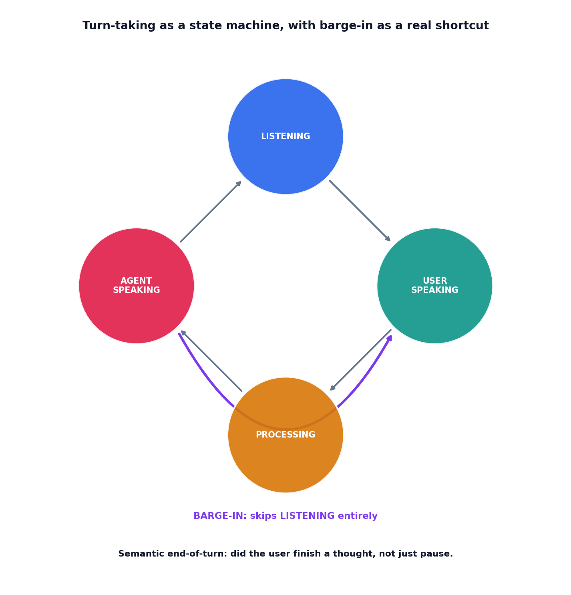

# Turn-taking and barge-in

## What the code showed you

A normal conversation turn cycling through four states and back to listening. A second run where the user interrupts mid-response, the state jumping directly from `AGENT_SPEAKING` to `USER_SPEAKING`, skipping `LISTENING` entirely, logged distinctly as a barge-in rather than a normal turn start.

## What's actually happening underneath that

Confirmed as current practice for realtime voice: modern systems use semantic voice activity detection, judging whether a speaker has actually finished a complete thought, rather than waiting on a fixed silence timer. This matters because a fixed timer fires on any pause, including the kind a person makes mid-sentence while thinking, which either cuts them off too early or leaves an awkward gap waiting for a timeout that was never actually meaningful.

Barge-in, confirmed as handled by the provider's own voice activity detection in current systems like the OpenAI Realtime API, is not an edge case bolted onto the happy path. It's a first-class state transition: the caller interrupting mid-response simply cuts off whatever the agent was saying, with no attempt to queue or resume the interrupted response. This topic's code models that directly as its own transition path, distinct from the normal cycle, rather than treating it as an exception to catch.

## Resources, in the order I'd actually use them

**For current provider-level turn-taking behavior**
- Current documentation for realtime voice APIs (OpenAI Realtime among them) describes semantic voice activity detection and provider-decided barge-in exactly as modeled in this topic's state machine, confirmed for this build.

## The one thing worth remembering

A voice agent's state machine needs an explicit transition for every way a conversation can actually unfold, including the ones that interrupt the happy path. Barge-in modeled as an afterthought tends to produce agents that either can't be interrupted at all or interrupt themselves incorrectly.
