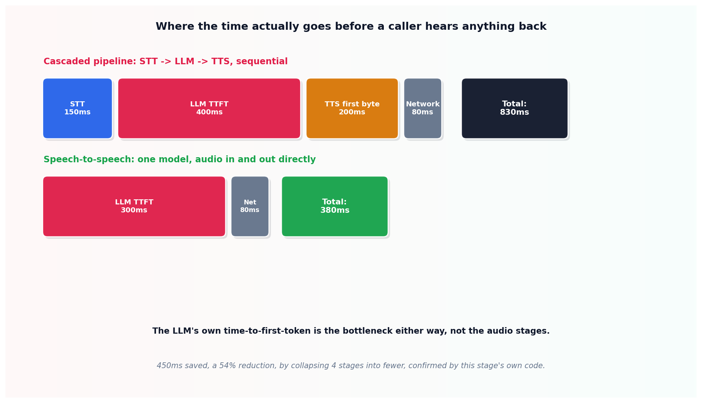

# Latency budgeting for realtime voice

## What the code showed you

A cascaded pipeline's four stages add up to 830ms before a caller hears anything back, with the LLM's own time-to-first-token, not the audio transcription or synthesis stages, eating the largest single share at 400ms. A speech-to-speech architecture, collapsing the same task into fewer stages, dropped the total to 380ms, a 54% reduction.

## What's actually happening underneath that

Voice latency gets noticed far more acutely than the same delay in a text chat, since silence on a call reads as the system being broken or the other party having hung up, not as normal processing time. A cascaded pipeline, speech-to-text then an LLM then text-to-speech, pays the latency cost of all three stages sequentially before producing any audio. This topic's own numbers show the counterintuitive part directly: the LLM's time-to-first-token was the single largest contributor, not the two audio stages most people assume are the bottleneck before actually measuring it.

This is also why prompt caching, established in this project's Stage 1, matters more in a voice context than a text one. Shaving time off the LLM stage directly shortens what a caller experiences as dead air, in a context where every additional hundred milliseconds is far more noticeable than the same delay in a typed conversation.

## Resources, in the order I'd actually use them

**For the current speech-to-speech provider landscape**
- Current voice-agent infrastructure sources confirm OpenAI Realtime, Gemini Live, AWS Nova Sonic, and xAI Realtime as the current speech-to-speech options, each handling audio in and audio out through a single model and connection rather than three separately orchestrated stages.

## The one thing worth remembering

Measure before assuming which stage is the bottleneck. This topic's own numbers put the LLM ahead of both audio stages combined, which runs against what most people would guess about where voice latency actually comes from.
