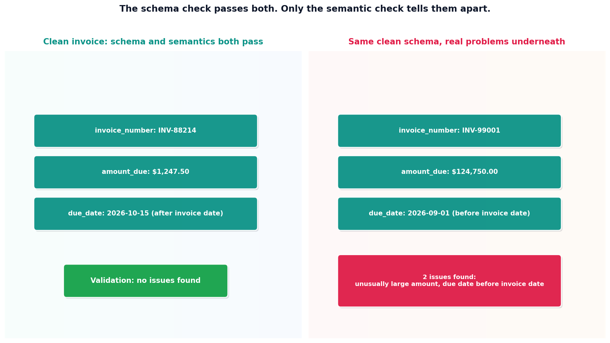

# Document extraction and validation

## What the code showed you

A clean simulated invoice extracted perfectly and passed validation with no issues. A second simulated invoice, with a due date before its invoice date and an unusually large amount, extracted just as cleanly, every field matching its expected pattern, and only got caught by the semantic validation layer checking what the numbers actually meant together.

## What's actually happening underneath that

This sandbox has no vision model or image file access, so the raw text this topic works from is explicitly labeled as simulated OCR output, standing in for what a tool like Docling or a vision model would have already produced from a real scanned invoice. This honesty matters structurally, not just as a disclaimer: the part this topic actually demonstrates, turning loosely-formatted extracted text into validated structured fields, is identical regardless of which tool produced that text in the first place, and it's where most of the real engineering effort in a document pipeline goes.

This is the same schema-then-semantics pattern established in this project's Stage 3, applied to a different kind of input. The second simulated invoice proves the point directly rather than just asserting it: a due date before an invoice date, and an amount two orders of magnitude larger than expected, both extracted with perfectly valid formatting. A schema check alone would have approved both. Only a check that looks at what the values mean in relation to each other catches either problem.

## Resources, in the order I'd actually use them

**For the real tool this topic's simulated step stands in for**
- Docling, IBM's open-source document conversion tool, handles the actual PDF parsing, table extraction, and OCR step this topic couldn't run directly, producing the kind of raw text this topic's code works from.

**For the validation pattern itself**
- This project's own Stage 3 reading on schema versus semantic validation covers the identical distinction established here, first demonstrated on a support ticket classifier rather than a document.

## The one thing worth remembering

A perfectly-formatted extracted field and a correct extracted field are different claims. The second simulated invoice in this topic's code satisfied every formatting rule while being wrong in two different, real ways, neither of which a schema check alone could have caught.
