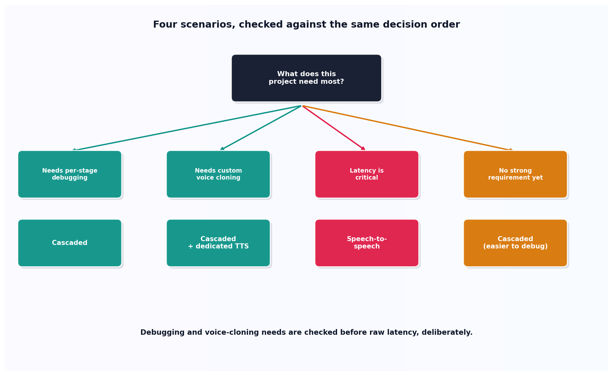

# Speech-to-speech vs. cascaded architecture

## What the code showed you

Four scenarios routed through one decision function. A latency-critical phone agent with no other constraints got routed to speech-to-speech. A team needing to debug each stage, and a project needing custom voice cloning, both got routed to a cascaded pipeline instead, even though the first of those two also flagged latency as critical.

## What's actually happening underneath that

Two genuinely different architectures exist for voice AI as of 2026: speech-to-speech models (OpenAI Realtime, Gemini Live, AWS Nova Sonic, xAI Realtime) handle audio in and audio out through one model and one connection, confirmed as the current lower-latency option by this stage's own measurement, a 54% reduction in this topic's worked example. Cascaded pipelines run separate speech-to-text, LLM, and text-to-speech stages, slower but with each stage independently inspectable, debuggable, and swappable for a different provider without touching the others.

The decision order in this topic's code is deliberate, not arbitrary. Debugging needs and voice-cloning requirements are checked before raw latency, because a team that genuinely needs to see what the transcription produced, or needs a specific cloned voice a speech-to-speech model's fixed voice options can't provide, will regret choosing the faster architecture regardless of how much time it saves. Latency is real and worth taking seriously, confirmed directly by this stage's own numbers, but it's one factor among several, not an automatic trump card.

## Resources, in the order I'd actually use them

**For the current speech-to-speech provider landscape**
- Current voice-agent infrastructure sources confirm OpenAI Realtime, Gemini Live, AWS Nova Sonic, and xAI Realtime as the current options, each trading the cascaded pipeline's flexibility for a single model's lower latency.

**For where the latency numbers this decision weighs against come from**
- This stage's own topic 2 measured the actual 830ms versus 380ms comparison cited here directly, not an estimate from elsewhere.

## The one thing worth remembering

The fastest architecture is not automatically the right one. A team that needs per-stage visibility or a specific cloned voice has a real requirement that speed doesn't substitute for, and this topic's own decision function checks those requirements before it ever asks how much latency matters.
