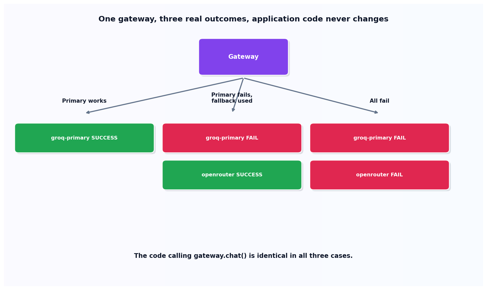

# The LLM gateway

## What the code showed you

Three scenarios run through the identical `gateway.chat()` call: the primary provider working normally, the primary failing and a backup picking up the request automatically, and both providers failing, correctly raising an error rather than hanging or returning a silent wrong answer. The application-facing call never changed across any of the three.

## What's actually happening underneath that

Confirmed as a current, real pattern: an LLM gateway, LiteLLM being the specific tool named in current sources, sits between an application and its backend providers so traffic can be redirected between OpenAI, Anthropic, a local vLLM instance, or a fallback provider without touching any application code. This topic's code builds the actual core of that pattern directly: try providers in priority order, catch failures, fall back, and log exactly what happened, which is the mechanism every gateway tool is built around regardless of how much additional functionality (cost tracking, load balancing) gets layered on top.

The genuinely important design detail, visible in this topic's test suite: the failure and recovery paths are both actually exercised with controllable fake providers, not just asserted to work in prose. A gateway that's never actually been made to fail and recover in a test is a gateway whose fallback behavior is unverified.

## Resources, in the order I'd actually use them

**For the real current tool this pattern is based on**
- LiteLLM is confirmed as the specific tool named in current sources for exactly this pattern, used in production systems to redirect traffic between OpenAI, Anthropic, local serving engines, and canary checkpoints without touching the calling code.

## The one thing worth remembering

The value of a gateway isn't the happy path, it's what happens when a provider goes down. A gateway only earns its place in a production system if its failure handling has actually been tested with a simulated failure, the same way this topic's own test suite does.
