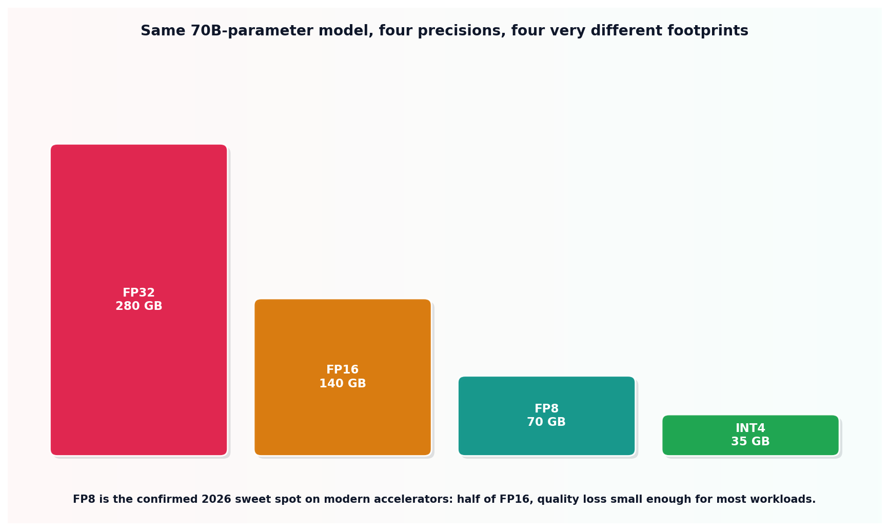

# Quantization

## What the code showed you

Six real weight values, quantized to INT8 and dequantized back, with a maximum error of 0.002 per weight, a small but real and permanent loss of precision. At a realistic 70-billion-parameter model size, the same precision choice meant the difference between 280 GB (FP32) and 35 GB (INT4) just to hold the weights in memory.

## What's actually happening underneath that

Quantization maps a continuous range of floating-point weight values onto a much smaller set of representable integer values, using a scale factor and a zero point computed directly from the weight range, exactly the calculation this topic's code performs rather than treating as a black box. Every weight gets rounded to its nearest representable value, which is where the small, permanent error this topic measured directly comes from.

Confirmed as the current 2026 default on modern accelerators: FP8 is the sweet spot, roughly halving FP16's memory footprint with quality loss small enough to be acceptable for most production workloads. INT4 goes further, down to an eighth of the original FP32 footprint, at a real, measurably larger quality cost, which is why it gets reached for specifically when memory is the binding constraint rather than used as an automatic default the way FP8 increasingly is.

## Resources, in the order I'd actually use them

**For the current default and why it's the default**
- Current 2026 production serving guides confirm FP8 as the sweet spot on modern accelerators directly, alongside PagedAttention and continuous batching (this stage's topic 1) as the three pillars of a modern serving stack.

## The one thing worth remembering

Quantization error is not a rounding artifact to wave away. It's a real, permanent, measurable change to every single weight in the model, multiplied across billions of parameters. The choice of precision is a genuine production tradeoff between memory and quality, not a free compression trick with no downside.
