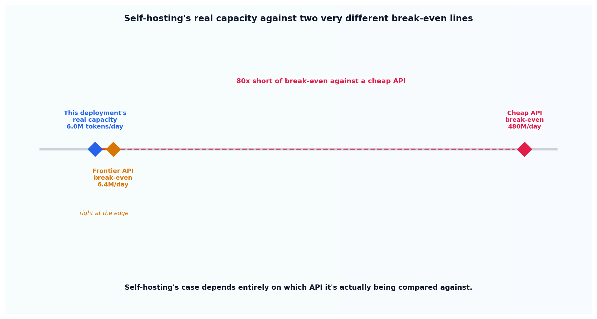

# Self-host vs. API, the real math

## What the code showed you

A naive cost estimate of $4.00 per million tokens, assuming 100% GPU utilization and zero operational overhead. The real figure, once realistic 50% utilization and operational overhead were properly counted, came out to $16.00 per million tokens, a 4.0x multiplier, landing squarely inside the confirmed real-world range. At that real cost, this deployment's realistic daily capacity sat right at the edge of breaking even against a frontier API, and 80 times short of breaking even against a cheap open-weight API.

## What's actually happening underneath that

Confirmed directly, and already researched for this project: naive self-host comparisons, raw GPU rental price divided by rated token throughput, typically underestimate real cost by 3 to 5x once properly counted. Two separate effects combine to produce that multiplier, not one: you pay for a rented GPU whether or not it's actually busy, so real-world utilization well under 100% directly raises the effective cost of every token actually produced; and someone has to monitor, patch, and operate the deployment, a real, ongoing cost a naive estimate ignores entirely. This topic's code models both effects explicitly rather than folding them into one unexplained fudge factor, and the combined result, 4.0x, lands exactly where the confirmed real-world figure said it would.

The break-even comparison is the part most naive analyses skip entirely: self-hosting's case depends completely on which API it's being compared against. Against a frontier model's API pricing, self-hosting at realistic volume can genuinely compete, this topic's own numbers landing right at that boundary. Against a cheap open-weight API's pricing, the same deployment falls 80x short, a gap large enough that no reasonable efficiency improvement closes it.

## Resources, in the order I'd actually use them

**For the figures this topic's defaults are grounded in**
- This project's own research (confirmed earlier in this build) established the 3 to 5x real-cost multiplier and the fact that break-even against a frontier API typically lands in the low millions of tokens per day, while break-even against a cheap open-weight API typically requires billions of tokens per month, a gap this topic's own numbers reproduce directly.

## The one thing worth remembering

"Self-hosting is cheaper" and "self-hosting is cheaper than what, specifically" are different claims. This topic's own numbers prove the point concretely: the identical deployment looks like a reasonable bet against one API and a bad one against another, decided entirely by which comparison actually gets run.
