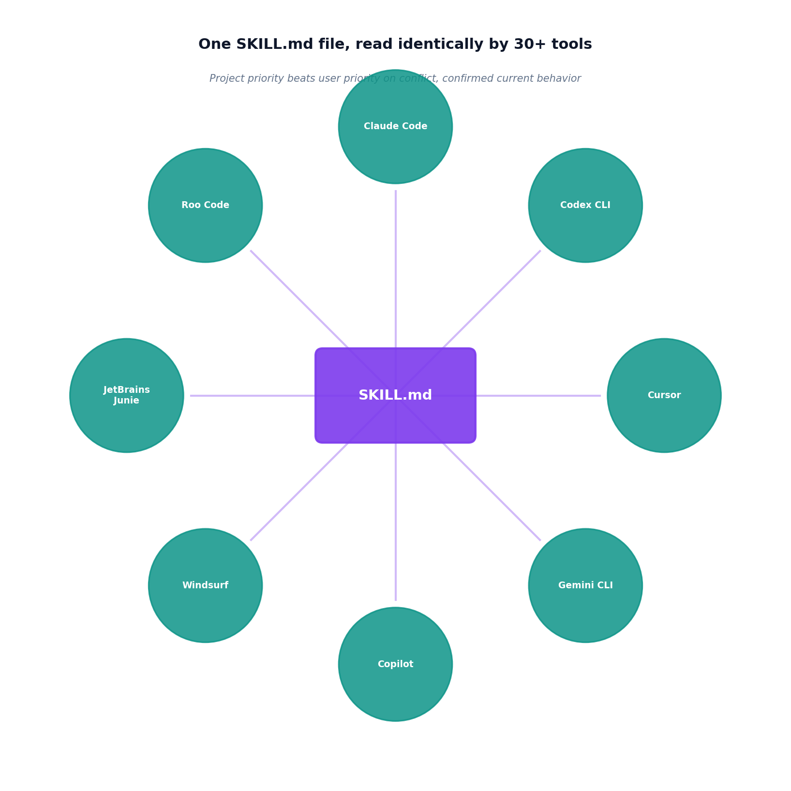

# The SKILL.md loader

## What the code showed you

Three simulated skills discovered and parsed, two of them both named "pdf-handling" but with genuinely conflicting instructions, one at project priority (use the pdf library) and one at user priority (use PyPDF2). When a task matched both, the project-level skill won, not by coincidence, by the priority logic actually resolving the conflict correctly.

## What's actually happening underneath that

SKILL.md is confirmed as a genuine open standard as of 2026, adopted across more than 30 tools including Claude Code, Codex CLI, Cursor, and Gemini CLI, replacing what used to be a fragmented landscape where Claude Code used CLAUDE.md, Codex CLI used AGENTS.md, and switching tools meant starting a team's conventions over from scratch. Each skill lives in its own directory with a SKILL.md file: YAML frontmatter carrying metadata and trigger conditions (`when_to_use`), followed by plain instructions.

The precedence logic this topic's code implements, project-level skills beating user-level ones on conflict, is confirmed as the real behavior current tools actually use, and it matters specifically because it's what lets a project's own conventions override a developer's personal defaults without the developer having to remember to disable anything manually. This project's own `stage-build-patterns.md` file, tracked across every stage built so far, is functionally the same idea: a living instruction file consulted before each new unit of work, the same pattern SKILL.md formalizes for coding agents generally.

## Resources, in the order I'd actually use them

**For the standard itself and the directory conventions**
- Current 2026 sources on the Agent Skills open standard confirm the `.agents/skills/` directory convention and the full priority order current tools search in: project-level first, then parent directory, then repository root, then user-level, then system-level skills, lowest priority last.

**For how a specific tool implements it**
- Codex CLI's skills ecosystem documentation shows the real trust-tier system (official, community, personal) layered on top of the same core SKILL.md format this topic's code parses directly.

## The one thing worth remembering

A skill's portability comes entirely from the format being boring and standardized: frontmatter, triggers, instructions, nothing tool-specific baked in. The moment a skill file starts assuming something about which specific tool will load it, that portability breaks, which is exactly why the standard's value is in what it deliberately leaves out.
