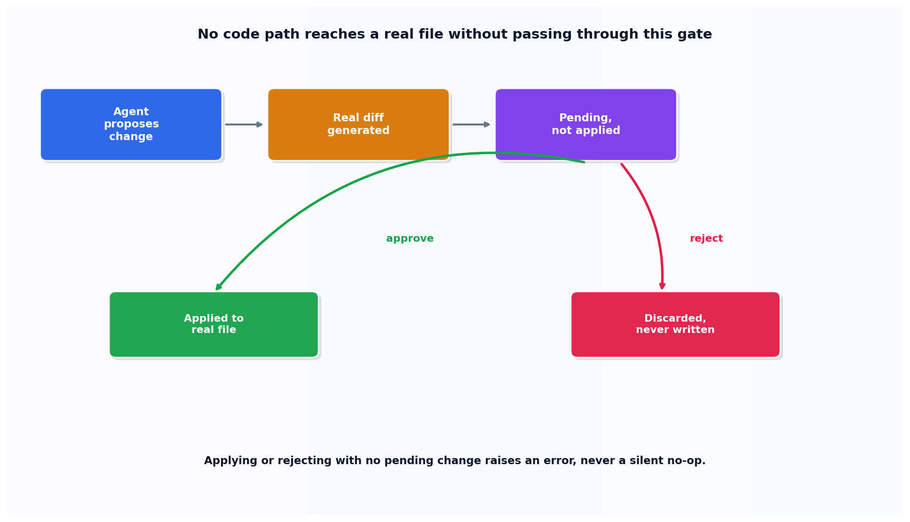

# The propose, diff, approve, apply harness

## What the code showed you

A proposed change generated a real unified diff and sat as a pending change, untouched, until a decision was made. A rejected change left zero trace in the applied-changes history. A corrected, approved version actually applied. Attempting to approve or reject with nothing pending raised an error rather than silently doing nothing.

## What's actually happening underneath that

A tool that can write files is dangerous if it writes them blindly, which is exactly the harness-engineering concern this project's Stage 9 established in general and this topic applies specifically to coding agents. The real pattern current tools use: propose the change, generate a genuine diff (the same format a human reviewer or `git diff` would show, not a vague text description), require explicit approval, and only then touch the real file.

The detail that makes this a real guarantee rather than a step an agent could accidentally skip, proven directly by this topic's code: there is no method on `FileEditHarness` that goes from "here's a proposed change" to "the file is now different" without passing through `approve_and_apply`. A rejected change isn't marked rejected and then applied anyway by a bug elsewhere, it's structurally impossible for that to happen, because the pending change is cleared, not kept, the moment it's rejected.

## Resources, in the order I'd actually use them

**For how this connects to this project's earlier harness work**
- This project's Stage 9 reading on checkpoint and recovery, and Stage 7's reading on tool permission scoping, cover related but distinct safety properties: recovery handles what happens after a crash, scoping handles which tools are reachable at all, and this topic's gate handles the specific moment between deciding a change and making it real.

## The one thing worth remembering

A diff a human never actually reads before approving provides none of this pattern's real safety benefit. The structural guarantee this topic's code provides, no path around the gate, is necessary but not sufficient. Someone still has to look at the diff.
