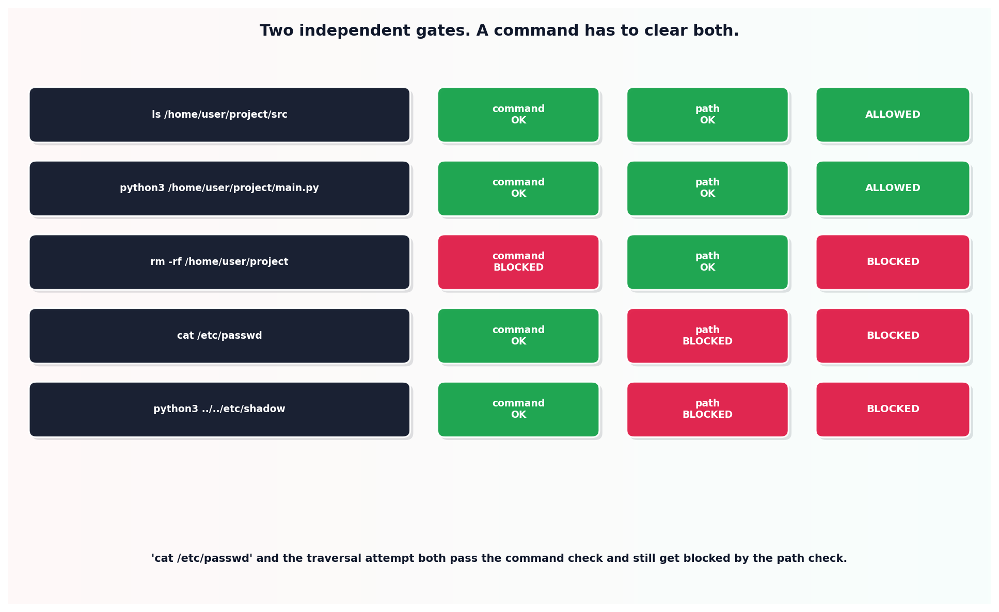

# Command sandboxing

## What the code showed you

Seven test commands run through two independent checks. `rm -rf` and `curl` got blocked because the base command itself was never on the allowed list, regardless of path. `cat /etc/passwd` passed the command check (cat was allowed) and still got blocked by the path check. A path-traversal attempt using `..` got blocked by its own dedicated check even though `python3` was an allowed command.

## What's actually happening underneath that

Confirmed as a real current differentiator between coding agent tools: Gemini CLI has the most mature OS-level sandboxing of the major terminal-based agents, with four separate backend implementation options, while every serious tool in this category implements some version of the same underlying idea. This topic's code builds that idea directly rather than treating "sandboxing" as a black box: an allowed-commands check and a path-boundary check, run as two genuinely separate gates rather than one combined pass/fail.

The reason they have to be separate, proven directly by the `cat /etc/passwd` test case: a command can be perfectly legitimate in general (cat is a normal, safe command most of the time) while still being dangerous for this specific invocation, because of where it's pointed. Collapsing both checks into one would either have to allow `cat` everywhere (unsafe) or block it everywhere (useless), when what's actually needed is allowing `cat` only inside the permitted directory, which requires the two checks to run independently.

## Resources, in the order I'd actually use them

**For how this connects to this project's earlier scoping work**
- This project's Stage 7 reading on tool permission scoping covers the same two-layer principle, applied there to named tools in a registry rather than raw shell commands. The underlying idea, which things exist versus which specific invocation is safe right now, repeats across both.

## The one thing worth remembering

A command allowlist alone is not a sandbox. This topic's own test cases prove it directly: an allowed command with the wrong path is exactly as dangerous as a disallowed command, and a real sandboxing layer has to catch both, independently, every time.
